What Drives Podcast Listens? EDA and Regression Analysis
================
Catalina Cortés Gutiérrez
2026-10-14

``` r
library(tidyverse)   # read_csv, dplyr, ggplot2
library(gridExtra)   # grid.arrange
library(Hmisc)       # rcorr
library(car)         # vif
library(emmeans)     # emmeans, pairs
options(width = 1000)
```

# Podcasts

This analysis explores what drives daily listens across 5,400 podcasts.
This analysis explores what drives daily listens across 5,400 podcasts.
Each row is one podcast, and each variable is averaged over several
months (for example, daily listens is the average number of listens per
day).

**Questions:**

1)  Do review scores and the number of reviews relate to daily listens?
2)  How do daily listens differ across genres?
3)  What is the effect of subscribers on daily listens, and does it
    differ across genres?

## Data Dictionary

The dataset variables are described in the table below:

| Variable      | Description                                                 |
|---------------|-------------------------------------------------------------|
| Platform      | Podcast streaming platform                                  |
| genre         | Podcast genre                                               |
| avg.review    | Average review to the podcast across all days in the period |
| daily.listens | Average number of listens across all days in the period     |
| total.reviews | Average number of reviews across all days in the period     |
| subscribers   | Average number of subscribers across all days in the period |

## I. Exploratory Data Analysis

### a) Load in the data and check it for integrity/quality

``` r
# First, read the data
podcasts <- read_csv("podcast_listens.csv")

# Preview data structure and types 
str(podcasts)
```

    ## spc_tbl_ [5,400 × 6] (S3: spec_tbl_df/tbl_df/tbl/data.frame)
    ##  $ Platform     : chr [1:5400] "Apple Podcasts" "Spotify" "Apple Podcasts" "YouTube" ...
    ##  $ genre        : chr [1:5400] "Comedy" "News & Culture" "Documentary" "Comedy" ...
    ##  $ avg.review   : num [1:5400] 3.78 4.7 3.98 4.71 4.7 4.55 4.4 4.84 3.66 4.34 ...
    ##  $ daily.listens: num [1:5400] 4683 4337 4278 4717 4268 ...
    ##  $ total.reviews: num [1:5400] 984 1005 968 1132 690 ...
    ##  $ subscribers  : num [1:5400] 550 340 694 622 311 ...
    ##  - attr(*, "spec")=
    ##   .. cols(
    ##   ..   Platform = col_character(),
    ##   ..   genre = col_character(),
    ##   ..   avg.review = col_double(),
    ##   ..   daily.listens = col_double(),
    ##   ..   total.reviews = col_double(),
    ##   ..   subscribers = col_double()
    ##   .. )
    ##  - attr(*, "problems")=<externalptr>

``` r
# Categorical variables ('Platform' and 'genre') show consistent frequencies (5,400)
# Values are standardised with no naming duplicates, ensuring category consistency
lapply(podcasts[c("Platform", "genre")], table)
```

    ## $Platform
    ## 
    ## Apple Podcasts     BBC Sounds        Spotify        YouTube 
    ##           3903            160            833            504 
    ## 
    ## $genre
    ## 
    ##         Comedy    Documentary News & Culture 
    ##           1800           1800           1800

``` r
# Convert categorical variables to a factor to properly handle them as groups
podcasts <- podcasts %>%
  mutate(
    Platform = factor(Platform),
    genre = factor(genre)
  )

# Descriptive stats check; potential outliers in avg. review, daily listens, total reviews and subscribers
summary(podcasts)
```

    ##            Platform               genre        avg.review      daily.listens  total.reviews     subscribers    
    ##  Apple Podcasts:3903   Comedy        :1800   Min.   :  0.000   Min.   :3951   Min.   :   0.0   Min.   :  -2.0  
    ##  BBC Sounds    : 160   Documentary   :1800   1st Qu.:  4.140   1st Qu.:4372   1st Qu.: 849.0   1st Qu.: 492.5  
    ##  Spotify       : 833   News & Culture:1800   Median :  4.440   Median :4507   Median : 958.0   Median : 614.2  
    ##  YouTube       : 504                         Mean   :  4.747   Mean   :4520   Mean   : 951.5   Mean   : 627.8  
    ##                                              3rd Qu.:  4.660   3rd Qu.:4663   3rd Qu.:1064.0   3rd Qu.: 760.9  
    ##                                              Max.   :100.000   Max.   :5188   Max.   :1506.0   Max.   :1191.9

``` r
# There are no NAs in the dataset
sum(is.na(podcasts))
```

    ## [1] 0

``` r
# # Outlier Analysis: 23 records with impossible 'avg.review' scores of 100.00
# 1 record with negative 'subscribers' (-2.00), which is contextually implausible
podcasts %>%
  filter(avg.review >5 | subscribers < 0) %>%
as.data.frame()
```

    ##          Platform          genre avg.review daily.listens total.reviews subscribers
    ## 1  Apple Podcasts         Comedy     100.00       4664.16             0      580.48
    ## 2  Apple Podcasts         Comedy     100.00       4865.09             0      584.45
    ## 3  Apple Podcasts    Documentary     100.00       4317.50             0      962.97
    ## 4  Apple Podcasts    Documentary     100.00       4344.57             0      837.50
    ## 5  Apple Podcasts    Documentary     100.00       4197.58             0      714.73
    ## 6         Spotify         Comedy     100.00       4442.82             0      630.92
    ## 7  Apple Podcasts    Documentary     100.00       4254.14             0      637.32
    ## 8  Apple Podcasts News & Culture     100.00       4593.85             0      517.54
    ## 9  Apple Podcasts News & Culture     100.00       4523.68             0      602.03
    ## 10 Apple Podcasts    Documentary     100.00       4296.75             0      896.92
    ## 11 Apple Podcasts News & Culture       4.66       4623.25          1354       -2.00
    ## 12 Apple Podcasts    Documentary     100.00       4504.93             0      978.68
    ## 13 Apple Podcasts News & Culture     100.00       4501.25             0      520.42
    ## 14 Apple Podcasts    Documentary     100.00       4540.21             0      681.18
    ## 15 Apple Podcasts News & Culture     100.00       4496.54             0      523.07
    ## 16 Apple Podcasts         Comedy     100.00       4693.18             0      661.94
    ## 17 Apple Podcasts    Documentary     100.00       4315.14             0     1018.47
    ## 18 Apple Podcasts News & Culture     100.00       4380.97             0      536.21
    ## 19 Apple Podcasts         Comedy     100.00       4519.90             0      405.97
    ## 20 Apple Podcasts    Documentary     100.00       4255.42             0      838.91
    ## 21 Apple Podcasts    Documentary     100.00       4307.36             0      663.90
    ## 22 Apple Podcasts    Documentary     100.00       4274.44             0      879.78
    ## 23 Apple Podcasts News & Culture     100.00       4463.23             0      525.64
    ## 24        Spotify         Comedy     100.00       4480.87             0      300.49

### b) Outliers check

``` r
# Histograms of the raw data (before cleaning) to spot impossible values
# avg.review: a separate bar at 100 reveals entry errors (valid scale is 0-5)
gg.Avgrev <- ggplot(podcasts, aes(x = avg.review)) +
  geom_histogram(bins = 50) + labs(subtitle = "Avg. review")
gg.dailis <- ggplot(podcasts, aes(x = daily.listens)) +
  geom_histogram(bins = 50) + labs(subtitle = "Daily listens")
gg.totrev <- ggplot(podcasts, aes(x = total.reviews)) +
  geom_histogram(bins = 50) + labs(subtitle = "Total reviews")
gg.sub <- ggplot(podcasts, aes(x = subscribers)) +
  geom_histogram(bins = 50) + labs(subtitle = "Subscribers")

# Daily listens by genre and by platform: one histogram per group
gg.DLByGen <- ggplot(podcasts, aes(x = daily.listens)) +
  geom_histogram(bins = 40) + facet_wrap(~ genre, ncol = 1) +
  labs(title = "Daily listens by genre")
gg.DLByPlat <- ggplot(podcasts, aes(x = daily.listens)) +
  geom_histogram(bins = 40) + facet_wrap(~ Platform, ncol = 1, scales = "free_y") +
  labs(title = "Daily listens by platform")

grid.arrange(gg.Avgrev, gg.dailis, gg.totrev, gg.sub, nrow = 2)
```

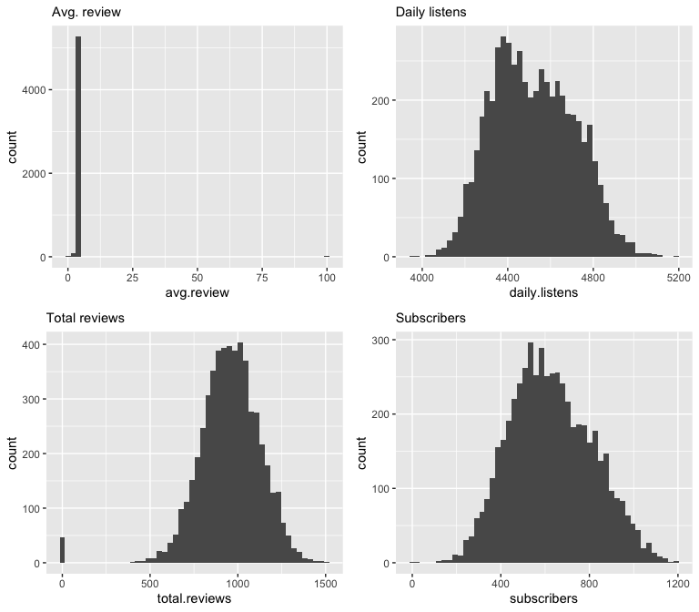

``` r
grid.arrange(gg.DLByGen, gg.DLByPlat, ncol = 2)
```

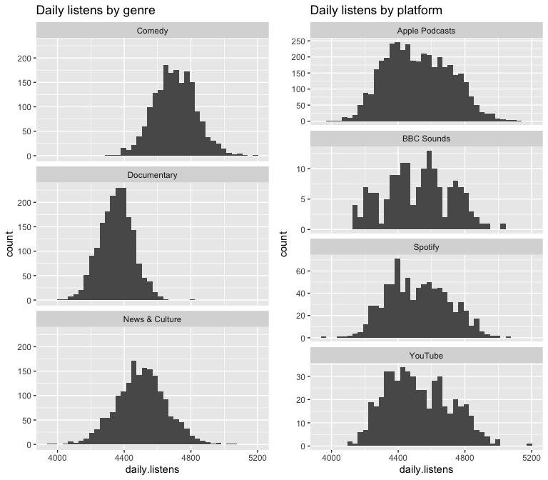

### c) Data Cleaning

``` r
# Remove outliers/records with contextually implausible values
podcasts_filtered <- podcasts %>%
  filter(avg.review <= 5 & subscribers >= 0)

# Cleaned data rows check: Verify 24 records were removed (5400 - 24 = 5376 records remain)
nrow(podcasts_filtered)
```

    ## [1] 5376

``` r
# Review records with zero average and total reviews (podcasts without reviews, avg.review recorded as 0)
podcasts_filtered %>%
  filter(avg.review == 0 | total.reviews == 0) %>%
as.data.frame()
```

    ##          Platform          genre avg.review daily.listens total.reviews subscribers
    ## 1  Apple Podcasts    Documentary          0       4424.61             0      920.80
    ## 2  Apple Podcasts    Documentary          0       4106.55             0      713.28
    ## 3         Spotify News & Culture          0       4265.99             0      358.27
    ## 4  Apple Podcasts         Comedy          0       4710.86             0      397.12
    ## 5  Apple Podcasts         Comedy          0       4641.26             0      534.07
    ## 6         Spotify News & Culture          0       4381.45             0      485.04
    ## 7  Apple Podcasts         Comedy          0       4699.11             0      637.51
    ## 8  Apple Podcasts         Comedy          0       4701.88             0      390.38
    ## 9  Apple Podcasts    Documentary          0       4290.31             0      987.25
    ## 10        Spotify    Documentary          0       4413.90             0      885.26
    ## 11 Apple Podcasts News & Culture          0       4585.11             0      140.98
    ## 12 Apple Podcasts    Documentary          0       4282.61             0      747.84
    ## 13 Apple Podcasts         Comedy          0       4434.10             0      433.61
    ## 14 Apple Podcasts         Comedy          0       4766.96             0      587.47
    ## 15 Apple Podcasts    Documentary          0       4295.72             0      759.64
    ## 16 Apple Podcasts News & Culture          0       4733.87             0      777.31
    ## 17 Apple Podcasts News & Culture          0       4542.37             0      261.16
    ## 18 Apple Podcasts    Documentary          0       4389.76             0      829.28
    ## 19 Apple Podcasts    Documentary          0       4351.83             0      776.20
    ## 20 Apple Podcasts         Comedy          0       4581.94             0      380.43
    ## 21        YouTube News & Culture          0       4908.43             0      569.96
    ## 22        Spotify         Comedy          0       4748.20             0      515.94
    ## 23 Apple Podcasts News & Culture          0       4293.16             0      277.83

``` r
# Remove records with zero average and total reviews (podcasts without reviews, avg.review recorded as 0)
podcasts_no_zerosReviews <- podcasts_filtered %>%
  filter(avg.review != 0 & total.reviews != 0)

# Verify removal: 5353 records should remain (5376 total - 23 zeros = 5353)
nrow(podcasts_no_zerosReviews)
```

    ## [1] 5353

**Note:** Two types of records were removed to ensure analysis and model
integrity:

- Outliers (24 records): Potential data entry errors (e.g., negative
  subscribers or reviews exceeding the scale) were excluded to ensure a
  robust analysis. These represent 0.44% of the original 5,400 rows.

- Podcasts without reviews (23 records): these are exactly the podcasts
  with zero total reviews. A podcast with no reviews has no average
  review score, but the data records it as 0. Keeping them would treat
  “not yet rated” as “the worst possible rating” and bias the effect of
  review scores. Since the question focuses on how reviews relate to
  listens, these records were excluded (0.43% of the dataset).

Subsequent modeling utilizes the remaining 5,353 records, focusing
exclusively on podcasts with active audience feedback.

### d) Understanding distributions

``` r
# Note: X and Y-axis scales are independent for each histogram
# 'genre' is balanced, 'Platform' is unbalanced (Apple Podcasts accounts for ~72.27%)
gg.Plat <- ggplot(podcasts_no_zerosReviews, aes(x = Platform)) + geom_bar()
gg.gen <- ggplot(podcasts_no_zerosReviews, aes(x = genre)) + geom_bar()
grid.arrange(gg.Plat, gg.gen, nrow=1)
```

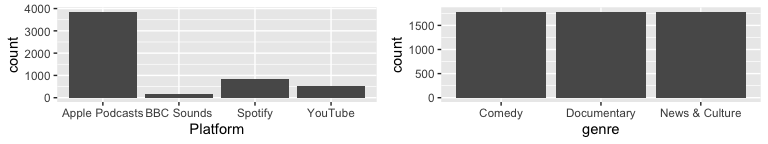

``` r
# Note: X and Y-axis scales are independent for each histogram
# 'daily.listens' shows a symmetrical distribution; 'subscribers' is roughly bell-shaped (normal), while 'avg.review' displays a strong left-skew, with a long tail towards lower scores
gg.AvgR <- ggplot(podcasts_no_zerosReviews) + 
  geom_histogram(aes(x=avg.review)) + labs(subtitle = "Avg. reviews")
gg.DL <- ggplot(podcasts_no_zerosReviews) + 
  geom_histogram(aes(x=daily.listens)) + labs(subtitle = "Daily listens")
gg.TR <- ggplot(podcasts_no_zerosReviews) + 
  geom_histogram(aes(x=total.reviews)) + labs(subtitle = "Total reviews")
gg.SU <- ggplot(podcasts_no_zerosReviews) + 
  geom_histogram(aes(x=subscribers)) + labs(subtitle = "Subscribers")
grid.arrange(gg.AvgR, gg.DL, gg.TR, gg.SU, nrow=2)
```

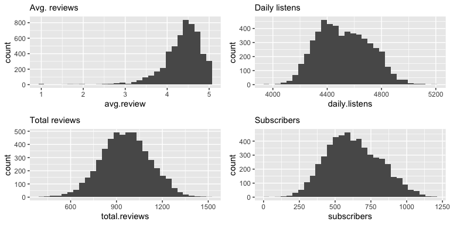

### e) Exploring relationships between variables

``` r
# The flat linear trend line suggests that average review scores have little to no visible impact on daily listening volume
gg.AvgRDL <-  ggplot(podcasts_no_zerosReviews, aes(x = avg.review , y = daily.listens)) + geom_jitter(alpha = 0.2, width = 0.05) + geom_smooth(method = "lm", linewidth = 1.5, se = FALSE) 

# Podcasts with a higher volume of total reviews are predicted to have higher daily listens
gg.totRevDL <- ggplot(podcasts_no_zerosReviews, aes(x = total.reviews, y = daily.listens)) + 
  geom_jitter(alpha = 0.2, width = 0.05) + geom_smooth(method = "lm", linewidth = 1.5, se = FALSE) 
grid.arrange(gg.AvgRDL, gg.totRevDL, nrow=1) 
```

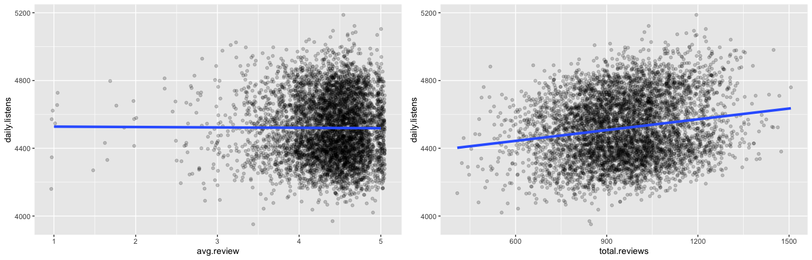

``` r
# When looking at the dataset as a whole, the downward slope suggests a misleading negative relationship caused by underlying genre differences
gg.DaiSubPla <-  ggplot(podcasts_no_zerosReviews, aes(x = subscribers, y = daily.listens)) + 
  geom_jitter(alpha = 0.2, width = 0.05) + geom_smooth(method = "lm", linewidth = 1.5, se = FALSE)

# When split by genre (Comedy, Documentary, News), every category shows a positive relationship between subscribers and daily listens
gg.totRevSubGen <- ggplot(podcasts_no_zerosReviews, aes(x = subscribers, y = daily.listens, colour = genre)) + 
  geom_jitter(alpha = 0.2, width = 0.05) + 
  geom_smooth(method = "lm", linewidth = 1.5, se = FALSE)+ 
  scale_colour_manual(values = c("#56B4E9", "#E69F00", "#009E73"))
grid.arrange(gg.DaiSubPla, gg.totRevSubGen, nrow=1) 
```

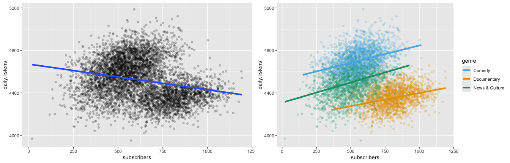

``` r
# Quantify relationships between continuous variables using a Spearman correlation matrix
rcorr(as.matrix(select(podcasts_no_zerosReviews, avg.review, daily.listens, total.reviews, subscribers)), type = "spearman")
```

    ##               avg.review daily.listens total.reviews subscribers
    ## avg.review          1.00         -0.01         -0.01        0.00
    ## daily.listens      -0.01          1.00          0.15       -0.27
    ## total.reviews      -0.01          0.15          1.00        0.08
    ## subscribers         0.00         -0.27          0.08        1.00
    ## 
    ## n= 5353 
    ## 
    ## 
    ## P
    ##               avg.review daily.listens total.reviews subscribers
    ## avg.review               0.4888        0.6881        0.9567     
    ## daily.listens 0.4888                   0.0000        0.0000     
    ## total.reviews 0.6881     0.0000                      0.0000     
    ## subscribers   0.9567     0.0000        0.0000

A Spearman correlation matrix was used to account for the non-normal
distribution of average review scores. The average review score showed
no significant directional relationship with daily listens
($r_s = -0.01, p = .489$), justifying its non-significant status in the
subsequent regression model.

While total reviews showed a significant positive association with daily
listens ($r_s = 0.15, p < .001$), subscriber counts demonstrated a
significant negative correlation ($r_s = -0.27, p < .001$). This
negative result directly contradicts the visual scatterplot, which shows
a positive relationship within each individual genre. These conflicting
findings confirm that categorical variables like genre distort the raw
data. Consequently, a Multiple Linear Regression (MLR) is required to
uncover the true drivers of audience reach by controlling for these
categorical differences.

## II. Key Drivers of daily listens

### a) Do podcasts have more/fewer listens depending upon their average review scores and total number of reviews?

``` r
# MLR model to identify primary drivers daily listens
m.daily.listens <- lm(daily.listens ~ avg.review + total.reviews, 
                 data = podcasts_no_zerosReviews)

# Check the coefficients, p-values, and overall model R-squared
summary(m.daily.listens)
```

    ## 
    ## Call:
    ## lm(formula = daily.listens ~ avg.review + total.reviews, data = podcasts_no_zerosReviews)
    ## 
    ## Residuals:
    ##     Min      1Q  Median      3Q     Max 
    ## -547.18 -149.98   -9.27  146.83  618.03 
    ## 
    ## Coefficients:
    ##                 Estimate Std. Error t value Pr(>|t|)    
    ## (Intercept)   4327.04014   29.47180 146.820   <2e-16 ***
    ## avg.review      -2.45362    5.72994  -0.428    0.669    
    ## total.reviews    0.21223    0.01612  13.166   <2e-16 ***
    ## ---
    ## Signif. codes:  0 '***' 0.001 '**' 0.01 '*' 0.05 '.' 0.1 ' ' 1
    ## 
    ## Residual standard error: 188.4 on 5350 degrees of freedom
    ## Multiple R-squared:  0.03141,    Adjusted R-squared:  0.03105 
    ## F-statistic: 86.75 on 2 and 5350 DF,  p-value: < 2.2e-16

``` r
# View the 95% CIs
confint(m.daily.listens)
```

    ##                      2.5 %       97.5 %
    ## (Intercept)   4269.2633968 4384.8168870
    ## avg.review     -13.6866354    8.7794051
    ## total.reviews    0.1806281    0.2438324

**Multiple regression shows that when holding all other factors
constant, daily listens is significantly predicted by total reviews**
($t(5350) = 13.17$, $p < .001$). Every 1 additional review predicts an
average increase of $0.21$ in daily listens ($CI = [0.18, 0.24]$), or
approximately 1 new daily listen for every 5 total reviews.**Average
review scores do not have a significant effect ($t(5350) = -0.43$,
$p = 0.669$) on daily listens** ($CI = [-13.69, 8.78]$).

The model establishes a baseline of 4,327.04 daily listens ($95\%$ CI
$[4269.26, 4384.82]$).Mathematically, this intercept represents a
podcast with zero total reviews and an average review score of zero,
which lies outside the analysed data, so it has no practical
interpretation.

The Adjusted $R^2$ ($0.0311$) **indicates that the model explains
approximately** 3.11% **of the total variation in daily listens**. While
total reviews are a significant driver, the remaining $96.89$% of the
variation is influenced by other factors not included in the model.

``` r
# Measure multicollinearity using VIFs
# Stable VIFs (all < 5)
vif(m.daily.listens)
```

    ##    avg.review total.reviews 
    ##      1.000002      1.000002

Analysis of VIFs confirms the structural integrity of the regression
model, with scores for both average review and total reviews remaining
nearly perfect $1.00$. These values fall significantly below the
threshold of 5, indicating no multicollinearity. The observed positive
impact of total review volume can be identified as a statistically
independent driver of daily listening volume, unaffected by average
review scores.

### b) Contrast the effect of listens across different genres

**Does the average number of daily listens differ significantly
depending on the Genre?**

``` r
# Single linear regression
m.genre.listens <- lm(daily.listens ~ genre, data = podcasts_no_zerosReviews)

# View the ANOVA table
anova(m.genre.listens)
```

    ## Analysis of Variance Table
    ## 
    ## Response: daily.listens
    ##             Df    Sum Sq  Mean Sq F value    Pr(>F)    
    ## genre        2 110633767 55316884  3464.8 < 2.2e-16 ***
    ## Residuals 5350  85414206    15965                      
    ## ---
    ## Signif. codes:  0 '***' 0.001 '**' 0.01 '*' 0.05 '.' 0.1 ' ' 1

``` r
# Check coefficients, p-values, and overall model R-squared
summary(m.genre.listens)
```

    ## 
    ## Call:
    ## lm(formula = daily.listens ~ genre, data = podcasts_no_zerosReviews)
    ## 
    ## Residuals:
    ##     Min      1Q  Median      3Q     Max 
    ## -551.17  -82.31    1.19   81.25  562.66 
    ## 
    ## Coefficients:
    ##                     Estimate Std. Error t value Pr(>|t|)    
    ## (Intercept)         4703.957      2.990 1573.32   <2e-16 ***
    ## genreDocumentary    -350.924      4.231  -82.94   <2e-16 ***
    ## genreNews & Culture -201.418      4.228  -47.64   <2e-16 ***
    ## ---
    ## Signif. codes:  0 '***' 0.001 '**' 0.01 '*' 0.05 '.' 0.1 ' ' 1
    ## 
    ## Residual standard error: 126.4 on 5350 degrees of freedom
    ## Multiple R-squared:  0.5643, Adjusted R-squared:  0.5642 
    ## F-statistic:  3465 on 2 and 5350 DF,  p-value: < 2.2e-16

``` r
# View the 95% CIs
confint(m.genre.listens)
```

    ##                         2.5 %   97.5 %
    ## (Intercept)         4698.0962 4709.819
    ## genreDocumentary    -359.2189 -342.629
    ## genreNews & Culture -209.7073 -193.129

ANOVA shows that **the genre of a podcast significantly impacts its
daily listens**, $F(2, 5350) = 3464.8, p < .001$. **Comedy podcasts
(baseline, intercept) have the highest reach**, with an estimated mean
of **4,704 daily listens** ($95\%$ CI $[4698.10, 4709.82]$). News &
Culture podcasts follow with approximately **201 fewer daily listens**
($t(5350) = -47.64$, $p < .001$) than Comedy
($CI = [-209.71, -193.13]$), while Documentaries have the lowest reach
($t(5350) = -82.94$, $p < .001$), averaging **351 fewer daily listens
than the Comedy group** ($CI = [-359.22, -342.63]$).

**While review volume was a statistically significant driver, genre is a
far more powerful predictor**, accounting for 56.42% (Adjusted
$R^{2} = 0.5642$) of the total variation in listening volume.

``` r
# Get estimated marginal means for each genre
( m.genre.emm <- emmeans(m.genre.listens, ~genre) )
```

    ##  genre          emmean   SE   df lower.CL upper.CL
    ##  Comedy           4704 2.99 5350     4698     4710
    ##  Documentary      4353 2.99 5350     4347     4359
    ##  News & Culture   4503 2.99 5350     4497     4508
    ## 
    ## Confidence level used: 0.95

``` r
# Pairwise Contrasts
( m.genre.pairs <- pairs(m.genre.emm) )
```

    ##  contrast                     estimate   SE   df t.ratio p.value
    ##  Comedy - Documentary              351 4.23 5350  82.937  <.0001
    ##  Comedy - News & Culture           201 4.23 5350  47.636  <.0001
    ##  Documentary - News & Culture     -150 4.23 5350 -35.334  <.0001
    ## 
    ## P value adjustment: tukey method for comparing a family of 3 estimates

``` r
# Get 95% CIs for those differences
( m.genre.diff_ci <- confint(m.genre.pairs) )
```

    ##  contrast                     estimate   SE   df lower.CL upper.CL
    ##  Comedy - Documentary              351 4.23 5350      341      361
    ##  Comedy - News & Culture           201 4.23 5350      192      211
    ##  Documentary - News & Culture     -150 4.23 5350     -159     -140
    ## 
    ## Confidence level used: 0.95 
    ## Conf-level adjustment: tukey method for comparing a family of 3 estimates

``` r
# Plot the pairwise differences between genres with their 95% CIs (Tukey-adjusted)
# A difference is significant when its interval does not cross the dashed line at 0
as.data.frame(m.genre.diff_ci) %>%
  ggplot(aes(x = estimate, y = contrast, xmin = lower.CL, xmax = upper.CL)) +
  geom_point(colour = "magenta") +
  geom_linerange(colour = "magenta") +
  geom_vline(xintercept = 0, linetype = "dashed") +
  labs(
    title = "Figure 1.1: Differences in Mean Daily Listens Between Genres",
    subtitle = "Error bars are 95% CIs (Tukey-adjusted)",
    x = "Difference in mean daily listens",
    y = NULL
  ) +
  theme_minimal()
```

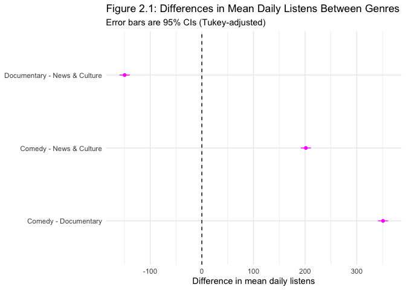<!-- -->
Pairwise contrasts using the Tukey method (to ensure the false error
rate remains at 5% for the entire set of comparisons rather than per
test) reveal significant differences in reach between all three podcast
genres ($p < .0001$ for all comparisons):

- **Comedy remains the most popular genre**, with a mean reach that is
  351 listens higher than Documentary ($CI = [341, 361]$) and 201
  listens higher than News & Culture ($CI = [192, 211]$)
- News & Culture podcasts are estimated to have 150 more daily listens
  on average than Documentary podcasts ($CI = [140, 159]$)

The tight confidence intervals across all comparisons indicate a high
level of precision in these estimates and confirm that genre is a robust
driver of audience volume.

``` r
# Model-estimated mean daily listens per genre over the raw data
# Shows the spread of individual podcasts within each genre
p.genre.raw <- ggplot(summary(m.genre.emm), aes(x = genre, y = emmean, ymin = lower.CL, ymax = upper.CL)) +
  geom_jitter(data = podcasts_no_zerosReviews,
              mapping = aes(x = genre, y = daily.listens),
              alpha = 0.05, width = 0.2, inherit.aes = FALSE) +
  geom_point(col = "magenta") +
  geom_linerange(col = "magenta") +
  ylim(3800, 5400) +
  labs(title = "Figure 1.2: Estimated Means and Raw Data",
       subtitle = "Error bars are 95% CIs (too narrow to be visible at this scale)",
       x = "Podcast genre", y = "Mean Daily Listens",
       caption = "Figure 1.2: Model-estimated mean daily listens (magenta) over raw daily listens\n(grey points), showing the spread of individual podcasts within each genre.") +
  theme_minimal() +
  theme(plot.title = element_text(hjust = 0),
        plot.caption = element_text(hjust = 0))

print(p.genre.raw)
```

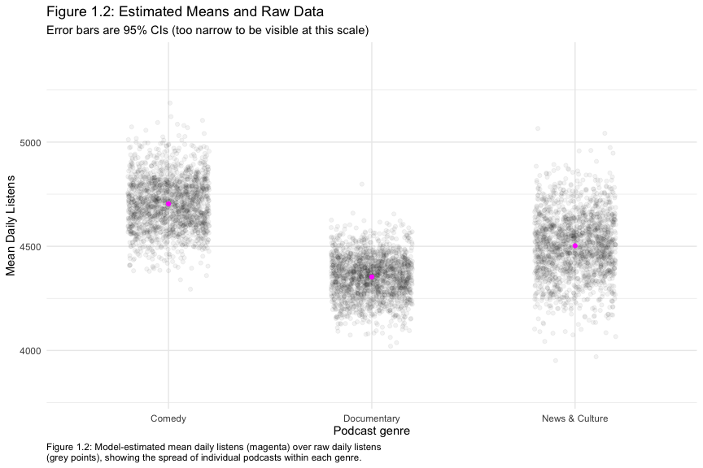

Figure 1.1 shows the estimated difference in mean daily listens between
each pair of genres. None of the confidence intervals crosses zero,
confirming that all three genres differ significantly. Figure 1.2
displays the estimated means alongside the raw data: while the genres
differ on average, many individual podcasts perform similarly across
genres.

### c) Interaction subscribers vs daily listens

**What is the effect of subscribers upon the number of listens, and is
this different across genres?**

``` r
# Main effects model. Assumes the effect of subscribers is the same for all genres
# Establishing the average impact of subscribers
m.main <- lm(daily.listens ~ subscribers + genre, data = podcasts_no_zerosReviews)

# Check the coefficients, p-values, and overall model R-squared
summary(m.main) 
```

    ## 
    ## Call:
    ## lm(formula = daily.listens ~ subscribers + genre, data = podcasts_no_zerosReviews)
    ## 
    ## Residuals:
    ##     Min      1Q  Median      3Q     Max 
    ## -570.70  -76.02   -0.66   76.37  508.84 
    ## 
    ## Coefficients:
    ##                       Estimate Std. Error t value Pr(>|t|)    
    ## (Intercept)         4525.01624    7.54515  599.73   <2e-16 ***
    ## subscribers            0.31951    0.01249   25.57   <2e-16 ***
    ## genreDocumentary    -431.67631    5.09188  -84.78   <2e-16 ***
    ## genreNews & Culture -185.88050    4.03766  -46.04   <2e-16 ***
    ## ---
    ## Signif. codes:  0 '***' 0.001 '**' 0.01 '*' 0.05 '.' 0.1 ' ' 1
    ## 
    ## Residual standard error: 119.3 on 5349 degrees of freedom
    ## Multiple R-squared:  0.6118, Adjusted R-squared:  0.6116 
    ## F-statistic:  2810 on 3 and 5349 DF,  p-value: < 2.2e-16

``` r
# View the 95% CIs
confint(m.main)
```

    ##                            2.5 %      97.5 %
    ## (Intercept)         4510.2246649 4539.807813
    ## subscribers            0.2950176    0.344005
    ## genreDocumentary    -441.6584679 -421.694144
    ## genreNews & Culture -193.7959610 -177.965036

``` r
# Measure multicollinearity using VIFs. 
# Ensure low/stable VIFs before adding interactions
vif(m.main)
```

    ##                 GVIF Df GVIF^(1/(2*Df))
    ## subscribers 2.023978  1        1.422666
    ## genre       2.023978  2        1.192756

``` r
# Interaction model. Tests if the subscriber effect differs by genre
m.interaction <- lm(daily.listens ~ subscribers * genre, data = podcasts_no_zerosReviews)

# Check the coefficients, p-values, and overall model R-squared
summary(m.interaction)
```

    ## 
    ## Call:
    ## lm(formula = daily.listens ~ subscribers * genre, data = podcasts_no_zerosReviews)
    ## 
    ## Residuals:
    ##     Min      1Q  Median      3Q     Max 
    ## -574.32  -76.12    0.70   76.28  498.85 
    ## 
    ## Coefficients:
    ##                                   Estimate Std. Error t value Pr(>|t|)    
    ## (Intercept)                     4521.50636   12.78340 353.701   <2e-16 ***
    ## subscribers                        0.32578    0.02226  14.632   <2e-16 ***
    ## genreDocumentary                -369.09082   22.12266 -16.684   <2e-16 ***
    ## genreNews & Culture             -212.70719   16.83776 -12.633   <2e-16 ***
    ## subscribers:genreDocumentary      -0.07895    0.03126  -2.526   0.0116 *  
    ## subscribers:genreNews & Culture    0.05305    0.03041   1.745   0.0811 .  
    ## ---
    ## Signif. codes:  0 '***' 0.001 '**' 0.01 '*' 0.05 '.' 0.1 ' ' 1
    ## 
    ## Residual standard error: 119.1 on 5347 degrees of freedom
    ## Multiple R-squared:  0.6132, Adjusted R-squared:  0.6128 
    ## F-statistic:  1695 on 5 and 5347 DF,  p-value: < 2.2e-16

``` r
# View the 95% CIs
confint(m.interaction)
```

    ##                                         2.5 %        97.5 %
    ## (Intercept)                      4.496446e+03 4546.56703172
    ## subscribers                      2.821317e-01    0.36942510
    ## genreDocumentary                -4.124602e+02 -325.72138621
    ## genreNews & Culture             -2.457161e+02 -179.69831434
    ## subscribers:genreDocumentary    -1.402300e-01   -0.01767034
    ## subscribers:genreNews & Culture -6.555771e-03    0.11265881

``` r
# Measure multicollinearity using VIFs
vif(m.interaction)
```

    ##                         GVIF Df GVIF^(1/(2*Df))
    ## subscribers         6.447611  1        2.539215
    ## genre             591.162031  2        4.930905
    ## subscribers:genre 717.545933  2        5.175621

Through a Multiple Linear Regression analysis ($N = 5,353$), the
**relationship between subscribers and daily listens was found to be
significantly moderated by podcast genre**
($F(2, 5347) = 9.63, p < .001$).

- In the baseline Comedy genre, every additional subscriber predicts a
  significant increase of 0.326 daily listens
  ($t(5347) = 14.63, p < .001, 95\%$ CI $[0.28, 0.37]$).
- The effect of subscribers is significantly weaker for Documentaries
  compared to the Comedy baseline
  ($\beta = -0.079, t(5347) = -2.53, p = .0116$). In this genre, the
  “bonus” per subscriber drops to approximately 0.247 listens.
- While News & Culture podcasts show a slightly stronger subscriber
  impact ($\beta = +0.053$), this difference did not reach the threshold
  for statistical significance ($t(5347) = 1.75, p = .0811$).

The intercept (4,521.5 daily listens) corresponds to a Comedy podcast
with zero subscribers, which lies outside the observed data (minimum:
150), so it has no practical interpretation. Compared to the simpler
main effects model ($R^2 = 0.6116$), the inclusion of interaction terms
provided a marginal improvement in predictive power, with the Adjusted
$R^2$ rising to 0.6128. **This final interaction model explains
approximately 61.28% of the total variation in daily listens**. While
subscribers and genre are robust predictors, the remaining 38.72% of the
variation is influenced by factors not included in this specific model.

Analysis of VIFs confirms the structural integrity of the main effects
model, with scores remaining nearly perfect at 1.43. While VIFs rose to
5.18 in the interaction model, this represents expected structural
multicollinearity from multiplying raw predictors. Because the
interaction is statistically significant (F(2, 5347) = 9.63, p \< .001),
this model is retained as a more accurate driver of listening volume.

``` r
# Model comparison: Main effects vs. Interaction
anova(m.main, m.interaction)
```

    ## Analysis of Variance Table
    ## 
    ## Model 1: daily.listens ~ subscribers + genre
    ## Model 2: daily.listens ~ subscribers * genre
    ##   Res.Df      RSS Df Sum of Sq      F    Pr(>F)    
    ## 1   5349 76109111                                  
    ## 2   5347 75835971  2    273141 9.6292 6.693e-05 ***
    ## ---
    ## Signif. codes:  0 '***' 0.001 '**' 0.01 '*' 0.05 '.' 0.1 ' ' 1

A formal model comparison using ANOVA confirmed that adding the
interaction between subscribers and genre significantly improved the
model’s fit ($F(2, 5347) = 9.6292, p < .001$). The interaction model
accounted for a significant reduction in the Residual Sum of Squares,
decreasing from 76,109,111 in the main-effects model to 75,835,971.
**This statistically justifies the selection of the more complex
interaction model**, as the additional terms provide a meaningful
increase in predictive power. This conclusion is further supported by
the slight increase in the Adjusted $R^2$ to 0.6128, compared to 0.6116
in the simpler main-effects model.

``` r
# Residual diagnostics for the final model
resid_df <- tibble(fitted = fitted(m.interaction),
                   residuals = residuals(m.interaction))

# 1) Residuals vs fitted: points should form a random cloud around 0 with similar spread
#    (fitted values cluster in three bands because genre drives most of the prediction)
gg.resfit <- ggplot(resid_df, aes(x = fitted, y = residuals)) +
  geom_point(alpha = 0.1) +
  geom_hline(yintercept = 0, linetype = "dashed") +
  labs(subtitle = "Residuals vs fitted")

# 2) Q-Q plot: points should follow the line if residuals are roughly normal
gg.qq <- ggplot(resid_df, aes(sample = residuals)) +
  stat_qq(alpha = 0.3) + stat_qq_line() +
  labs(subtitle = "Normal Q-Q plot of residuals")

grid.arrange(gg.resfit, gg.qq, nrow = 1)
```

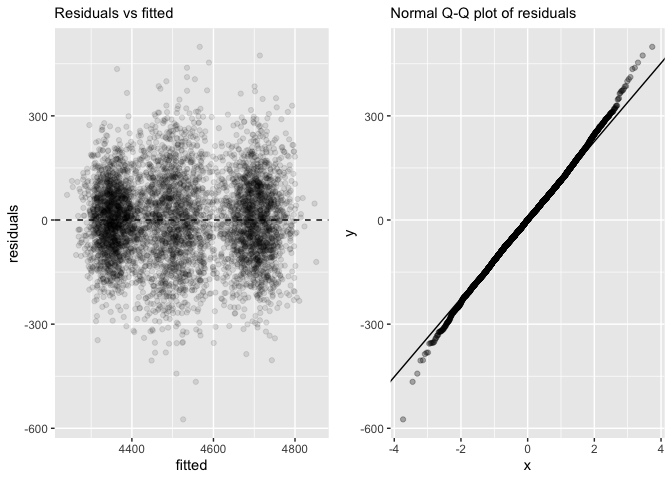<!-- -->
Residual diagnostics support the model: residuals are centred on zero
across fitted values and are approximately normal, with slightly heavier
tails at the extremes. The spread is somewhat larger for News & Culture
than for Documentary podcasts, so predictions are less precise for that
genre, but with over 5,000 observations this does not change the
conclusions.

``` r
# Get predicted listens per genre at the mean subscriber level
m.int.emm <- emmeans(m.interaction, ~ genre)

# Compare genres to each other (including News vs Documentary)
pairs(m.int.emm)
```

    ##  contrast                     estimate   SE   df t.ratio p.value
    ##  Comedy - Documentary              419 5.89 5347  71.132  <.0001
    ##  Comedy - News & Culture           179 4.90 5347  36.631  <.0001
    ##  Documentary - News & Culture     -239 6.18 5347 -38.724  <.0001
    ## 
    ## P value adjustment: tukey method for comparing a family of 3 estimates

``` r
# Get the 95% CIs for those comparisons
confint(pairs(m.int.emm))
```

    ##  contrast                     estimate   SE   df lower.CL upper.CL
    ##  Comedy - Documentary              419 5.89 5347      405      432
    ##  Comedy - News & Culture           179 4.90 5347      168      191
    ##  Documentary - News & Culture     -239 6.18 5347     -254     -225
    ## 
    ## Confidence level used: 0.95 
    ## Conf-level adjustment: tukey method for comparing a family of 3 estimates

Pairwise contrasts using the Tukey method reveal significant differences
in reach between all three podcast genres ($p < .0001$ for all
comparisons):

- Comedy remains the most popular genre, with a mean reach that is 419
  listens higher than Documentary (95% CI $[405, 432]$) and 179 listens
  higher than News & Culture (95% CI $[168, 191]$).
- News & Culture podcasts are estimated to have 239 more daily listens
  on average than Documentary podcasts (95% CI $[225, 254]$).

The tight confidence intervals across all comparisons indicate a high
level of precision in these estimates and confirm that genre is a robust
driver of audience volume.

``` r
# Prediction grid within the observed subscriber range of each genre
# (predicting beyond the observed data would be extrapolation)
sub.preds <- podcasts_no_zerosReviews %>%
  group_by(genre) %>%
  reframe(subscribers = seq(min(subscribers), max(subscribers), length.out = 50))

sub.preds$listens.hat <- predict(m.interaction, newdata = sub.preds)

# Plotting the interaction using standard ggplot logic
ggplot(sub.preds, aes(x = subscribers, y = listens.hat, colour = genre, lty = genre)) +  
  geom_line(linewidth = 1) +  
  labs(
    title = "Figure 1.3: Predicted Daily Listens by Genre and Subscriber Count",
    caption = "Figure 1.3: Regression slopes illustrate how the effect of subscribers on daily reach is\nmoderated by genre. The shallower slope for Documentaries (p = .0116) indicates a lower\nreturn in listens per additional subscriber compared to Comedy.",
    colour = "Genre",  
    lty = "Genre",
    x = "Number of Subscribers",
    y = "Predicted Daily Listens"
  ) + 
  theme_minimal() + 
  theme(
    plot.title = element_text(hjust = 0),    
    plot.caption = element_text(hjust = 0)
  )
```

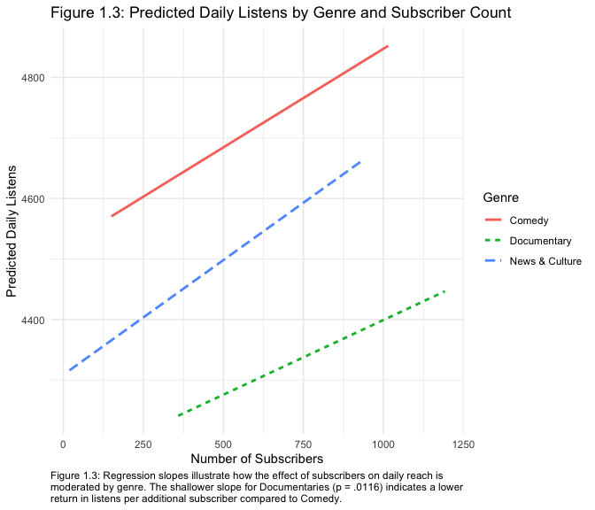

Figure 1.3 displays predicted daily listens generated from the final
interaction model. To illustrate these trends, predicted values were
calculated across the observed range of subscribers for each genre.

The visualization illustrates two primary trends. First, the positive
slopes across all genres confirm that increasing the subscriber base
predicts higher daily reach, with the Comedy baseline gaining 0.326
listens per additional subscriber ($t(5347) = 14.63, p < .001$). Second,
Documentaries show a significantly weaker slope
($t(5347) = -2.526, p = .0116$); the interaction effect is visually
confirmed by the lack of parallel alignment between the slopes. The
visibly flatter regression line for this genre indicates that the
‘return’ on new subscribers is significantly lower for Documentaries
than for Comedy podcasts, suggesting that genre-specific engagement
patterns must be accounted for to accurately predict reach.

------------------------------------------------------------------------

## Figuras para el artículo en español

``` r
# Etiquetas en español y un color fijo por género para todas las figuras
a_espanol <- function(x) fct_recode(x,
  "Comedia" = "Comedy",
  "Documental" = "Documentary",
  "Noticias y cultura" = "News & Culture")

colores_genero <- c("Comedia" = "#56B4E9",
                    "Documental" = "#E69F00",
                    "Noticias y cultura" = "#009E73")

podcasts_es <- podcasts_no_zerosReviews %>%
  mutate(genero = a_espanol(genre))

miles <- scales::label_number(big.mark = ",")
```

``` r
p.todos <- ggplot(podcasts_es, aes(x = subscribers, y = daily.listens)) +
  geom_point(alpha = 0.15, colour = "grey60") +
  geom_smooth(method = "lm", se = FALSE, colour = "black", linewidth = 1.2) +
  scale_x_continuous(labels = miles, breaks = seq(0, 1200, by = 300),
                     limits = c(0, 1200)) +
  scale_y_continuous(labels = miles) +
  labs(title = "Todos juntos: la tendencia baja",
       x = "Suscriptores", y = "Escuchas diarias") +
  theme_minimal(base_size = 13) +
  theme(plot.margin = margin(10, 20, 10, 10))

p.genero <- ggplot(podcasts_es, aes(x = subscribers, y = daily.listens, colour = genero)) +
  geom_point(alpha = 0.15) +
  geom_smooth(method = "lm", se = FALSE, linewidth = 1.2) +
  scale_colour_manual(values = colores_genero) +
  scale_x_continuous(labels = miles, breaks = seq(0, 1200, by = 300),
                     limits = c(0, 1200)) +
  scale_y_continuous(labels = miles) +
  labs(title = "Separados por género: la tendencia sube",
       x = "Suscriptores", y = "Escuchas diarias", colour = NULL) +
  theme_minimal(base_size = 13) +
  theme(legend.position = "bottom",
        plot.margin = margin(10, 20, 10, 10))

fig1 <- arrangeGrob(p.todos, p.genero, nrow = 1,
                    top = grid::textGrob("Mismos datos, conclusión opuesta",
                                         gp = grid::gpar(fontsize = 17, fontface = "bold")))
grid::grid.draw(fig1)
```

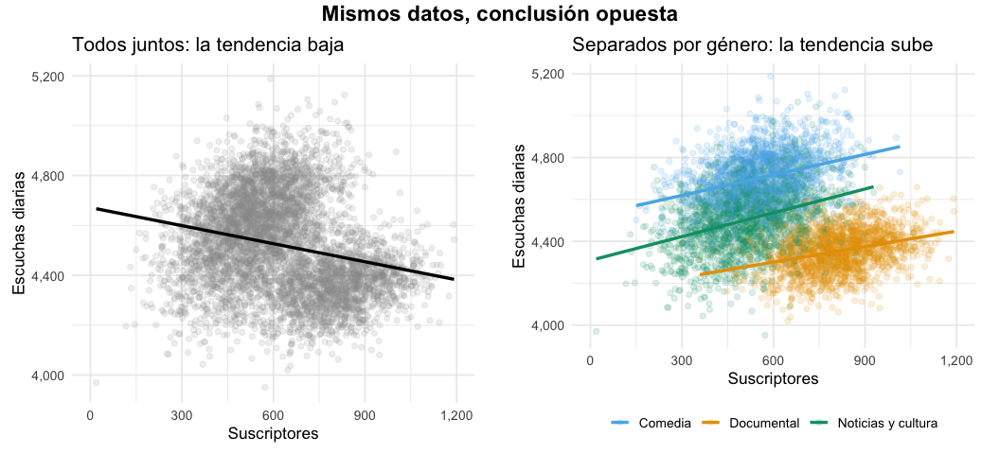<!-- -->

``` r
ggsave("fig1-paradoja.png", fig1, width = 11, height = 5, dpi = 200, bg = "white")
```

``` r
medias_genero <- as.data.frame(summary(m.genre.emm)) %>%
  mutate(genero = a_espanol(genre))

fig2 <- ggplot(medias_genero, aes(x = genero, y = emmean, colour = genero)) +
  geom_jitter(data = podcasts_es, aes(x = genero, y = daily.listens),
              alpha = 0.08, width = 0.2, inherit.aes = FALSE, colour = "grey60") +
  geom_point(size = 4) +
  geom_linerange(aes(ymin = lower.CL, ymax = upper.CL), linewidth = 1) +
  geom_text(aes(label = miles(round(emmean))), nudge_x = 0.32,
            size = 4.5, fontface = "bold", show.legend = FALSE) +
  scale_colour_manual(values = colores_genero, guide = "none") +
  scale_y_continuous(labels = miles) +
  labs(title = "La comedia lidera en escuchas diarias",
       subtitle = "Promedio por género (punto de color) sobre cada podcast (puntos grises)",
       x = NULL, y = "Escuchas diarias") +
  theme_minimal(base_size = 13)

print(fig2)
```

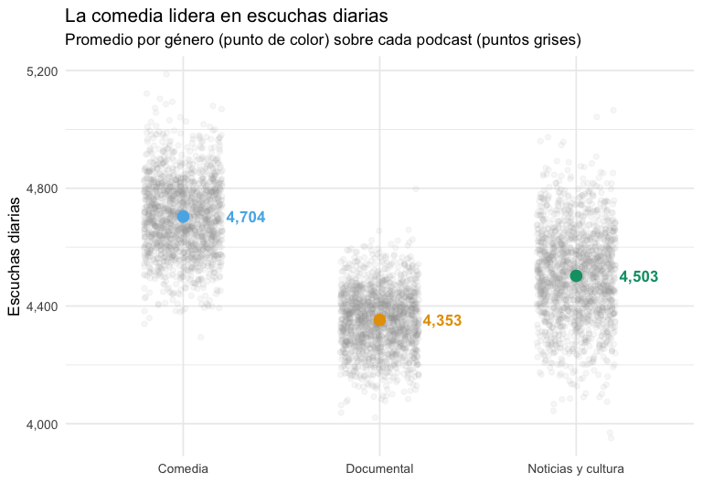<!-- -->

``` r
ggsave("fig2-genero.png", fig2, width = 8, height = 5.5, dpi = 200, bg = "white")
```

``` r
pred_es <- sub.preds %>%
  mutate(genero = a_espanol(genre))

etiquetas <- pred_es %>%
  group_by(genero) %>%
  slice_max(subscribers, n = 1)

fig3 <- ggplot(pred_es, aes(x = subscribers, y = listens.hat, colour = genero)) +
  geom_line(linewidth = 1.3) +
  geom_text(data = etiquetas, aes(label = genero), hjust = -0.08,
            size = 4.5, fontface = "bold") +
  scale_colour_manual(values = colores_genero, guide = "none") +
  scale_x_continuous(labels = miles, expand = expansion(mult = c(0.02, 0.25))) +
  scale_y_continuous(labels = miles) +
  labs(title = "Cada suscriptor rinde menos en documentales",
       subtitle = "Escuchas diarias estimadas según los suscriptores (solo dentro del rango observado)",
       caption = "Por cada 100 suscriptores: comedia ≈ +33 escuchas diarias; documental ≈ +25.",
       x = "Suscriptores", y = "Escuchas diarias estimadas") +
  theme_minimal(base_size = 13) +
  theme(plot.caption = element_text(hjust = 0))

print(fig3)
```

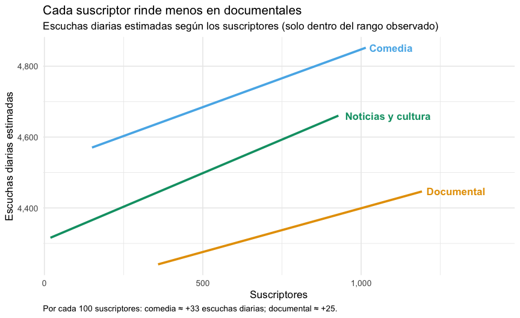<!-- -->

``` r
ggsave("fig3-suscriptores.png", fig3, width = 9, height = 5.5, dpi = 200, bg = "white")
```
