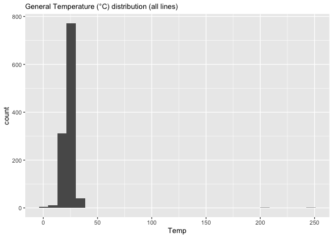
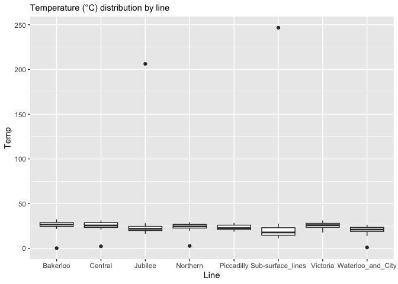
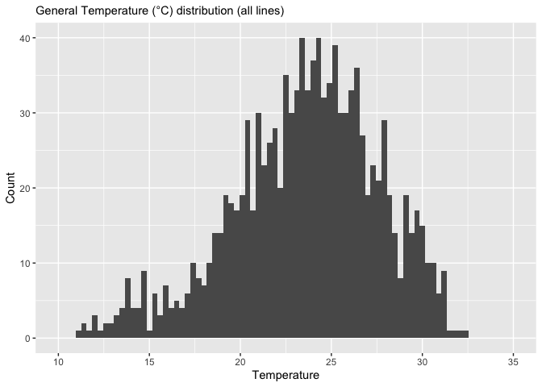
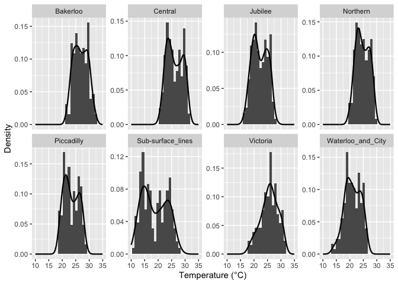
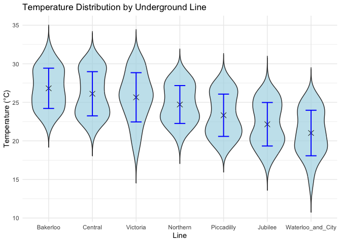
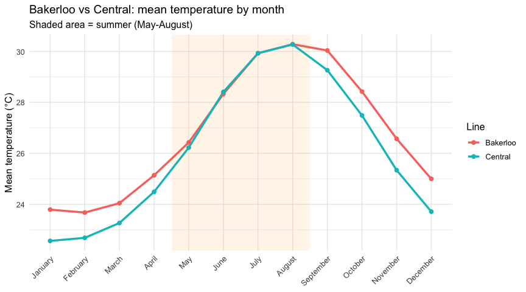
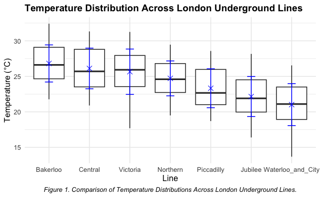

London Underground Temperatures: Statistical vs Practical Significance
================
Catalina Cortés Gutiérrez
2026-10-17

# The difference in the data was real, but in practice not relevant

**Scenario (hypothetical):** A pilot air-cooling system will be
installed on one London Underground line. To decide where, I analysed
monthly average temperatures for each line from 2013 to 2024.

The dataset also includes the older “Sub-Surface Lines”, which are built
closer to the surface than the other lines. Because their conditions are
not comparable with the deep-level lines, they were excluded from the
analysis.

------------------------------------------------------------------------

## Data Dictionary

The dataset variables are described in the table below:

| Variable | Description                                                 |
|----------|-------------------------------------------------------------|
| ID       | Unique identifier for each observation (row) in the dataset |
| Year     | Year of the data                                            |
| Month    | Month of the year                                           |
| Line     | London Underground Line                                     |
| Temp     | Temperature, measured in Celcius degrees                    |

``` r
library(tidyverse)
options(width=100)
options(digits = 6)
```

## 1. General Exploratory Data Analysis

``` r
# First, read the data
underground <- read_csv("Underground.csv")
```

``` r
# Get a quick preview of variable structure. Verify data classes and size 
str(underground)
```

    ## spc_tbl_ [1,152 × 5] (S3: spec_tbl_df/tbl_df/tbl/data.frame)
    ##  $ ID   : chr [1:1152] "TFL00001" "TFL00002" "TFL00003" "TFL00004" ...
    ##  $ Year : num [1:1152] 2013 2013 2013 2013 2013 ...
    ##  $ Month: chr [1:1152] "January" "January" "January" "January" ...
    ##  $ Line : chr [1:1152] "Bakerloo" "Central" "Jubilee" "Northern" ...
    ##  $ Temp : num [1:1152] 22 21 16.4 19.5 19.3 ...
    ##  - attr(*, "spec")=
    ##   .. cols(
    ##   ..   ID = col_character(),
    ##   ..   Year = col_double(),
    ##   ..   Month = col_character(),
    ##   ..   Line = col_character(),
    ##   ..   Temp = col_double()
    ##   .. )
    ##  - attr(*, "problems")=<externalptr>

``` r
# Check descriptive statistics (Min, Max, Mean) 
# The Min. and Max. temperatures seem to be outliers or potential entry errors
summary(underground)
```

    ##       ID                 Year         Month               Line                Temp       
    ##  Length:1152        Min.   :2013   Length:1152        Length:1152        Min.   :  0.27  
    ##  Class :character   1st Qu.:2016   Class :character   Class :character   1st Qu.: 21.06  
    ##  Mode  :character   Median :2018   Mode  :character   Mode  :character   Median : 23.90  
    ##                     Mean   :2018                                         Mean   : 23.86  
    ##                     3rd Qu.:2021                                         3rd Qu.: 26.35  
    ##                     Max.   :2024                                         Max.   :246.70  
    ##                                                                          NA's   :11

``` r
# All IDs are unique (disregarding missing values). Returns TRUE
n_distinct(na.omit(underground$ID)) == length(na.omit(underground$ID))
```

    ## [1] TRUE

``` r
# Categories are unique and standardised
# All categorical variables (Year, Month, Line) show consistent frequencies, confirming the dataset is balanced. Every line has 12 years of monthly data, and every year/month is represented by all 8 lines
lapply(underground[c("Year", "Month", "Line")], table)
```

    ## $Year
    ## 
    ## 2013 2014 2015 2016 2017 2018 2019 2020 2021 2022 2023 2024 
    ##   96   96   96   96   96   96   96   96   96   96   96   96 
    ## 
    ## $Month
    ## 
    ##     April    August  December  February   January      July      June     March       May  November 
    ##        96        96        96        96        96        96        96        96        96        96 
    ##   October September 
    ##        96        96 
    ## 
    ## $Line
    ## 
    ##          Bakerloo           Central           Jubilee          Northern        Piccadilly 
    ##               144               144               144               144               144 
    ## Sub-surface_lines          Victoria Waterloo_and_City 
    ##               144               144               144

``` r
# Explore all records (rows) that contain at least one missing value (NA)
# 18 rows contain at least one missing value: 11 missing Temp and 7 missing ID
# 6 of the missing values are clustered on the Piccadilly Line, suggesting a systematic reporting issue for that line. The rest appear random across Year, Month, and Line
as.data.frame(
  underground %>%
    filter(rowSums(is.na(.)) > 0)
)
```

    ##          ID Year     Month              Line  Temp
    ## 1  TFL00036 2013       May          Northern    NA
    ## 2  TFL00061 2013    August        Piccadilly    NA
    ## 3      <NA> 2013  December          Victoria 20.00
    ## 4  TFL00155 2014    August           Jubilee    NA
    ## 5  TFL00224 2015     April Sub-surface_lines    NA
    ## 6      <NA> 2015 September Waterloo_and_City 23.95
    ## 7  TFL00319 2016     April Waterloo_and_City    NA
    ## 8      <NA> 2016      June           Central 27.98
    ## 9  TFL00333 2016      June        Piccadilly    NA
    ## 10 TFL00399 2017  February Waterloo_and_City    NA
    ## 11 TFL00581 2019   January        Piccadilly    NA
    ## 12 TFL00821 2021      July        Piccadilly    NA
    ## 13     <NA> 2022     April          Bakerloo 24.83
    ## 14     <NA> 2022      June           Jubilee 24.10
    ## 15 TFL01037 2023   October        Piccadilly    NA
    ## 16     <NA> 2024     March Waterloo_and_City 18.50
    ## 17     <NA> 2024      June Waterloo_and_City 22.20
    ## 18 TFL01149 2024  December        Piccadilly    NA

### a) Categorical Data Validation

``` r
# Convert 'Month' to a factor with calendar sequence levels
underground_copy <- mutate(underground,
            Month = factor(Month,
              levels = c("January", "February", "March", "April", "May", "June", "July", "August", "September", "October", "November", "December")))

# The seasonal trend (warmer in summer, colder in winter) confirms the data's general accuracy. However, outliers appear to be impacting the mean temperatures for March, April, July, August, and September
underground_copy %>%
  group_by(Month) %>%
  summarise(
    mean = round(mean(Temp, na.rm = TRUE), 2), 
    min = min(Temp, na.rm = TRUE), 
    max = max(Temp, na.rm = TRUE)
  ) %>%
  as.data.frame()
```

    ##        Month  mean   min    max
    ## 1    January 20.05 11.18  26.00
    ## 2   February 20.25 11.30  26.60
    ## 3      March 22.71 11.40 206.30
    ## 4      April 21.83  0.27  27.10
    ## 5        May 23.67 16.17  28.50
    ## 6       June 25.76 20.12  30.33
    ## 7       July 29.45  2.32 246.70
    ## 8     August 27.32  1.05  32.24
    ## 9  September 26.47  2.74  31.40
    ## 10   October 24.95 17.64  30.28
    ## 11  November 22.73 15.31  27.82
    ## 12  December 21.11 12.21  26.44

### b) Visualisation of continuous variable “Temp”

``` r
# Temp is right-skewed due to potential errors (values > 100.00°C) 
# There are also outliers visible near zero. 11 rows with Temp NAs are disregarded
ggplot(underground) + 
  geom_histogram(aes(x=Temp)) +
  labs(subtitle = "General Temperature (°C) distribution (all lines)")
```

<!-- -->

``` r
# Low outliers (< 5.00°C) were observed on Bakerloo, Central, Northern, and Waterloo & City Lines. High outliers (> 100.00°C) were observed on Jubilee and Sub-surface Lines
# All identified outliers require investigation
# 11 rows with Temp NAs are disregarded
ggplot(underground) +
  geom_boxplot(aes(x = Line, y = Temp)) +
  labs(subtitle = "Temperature (°C) distribution by line")
```

<!-- -->

``` r
# Outliers analysis: extreme high values (206.30°C, 246.70°C) are physically impossible. Low outliers (< 5.00°C) are contextually implausible for the given months and statistically inconsistent with the monthly means (see Categorical Data Validation)
underground %>%
  filter(Temp > 100.00 | Temp < 5.00) %>%
as.data.frame()
```

    ##         ID Year     Month              Line   Temp
    ## 1 TFL00121 2014     April          Bakerloo   0.27
    ## 2 TFL00307 2016     March           Jubilee 206.30
    ## 3 TFL00440 2017      July Sub-surface_lines 246.70
    ## 4 TFL00452 2017 September          Northern   2.74
    ## 5 TFL00530 2018      July           Central   2.32
    ## 6 TFL00735 2020    August Waterloo_and_City   1.05

``` r
# Excluding errors and outliers (17 rows) the general distribution (for all data) is nearly bell-shaped
# Data has multiple peaks, and is centered near 25.00°C
ggplot(underground, aes(x=Temp)) +
  geom_histogram(binwidth = 0.3) +
  xlim(10, 35) +
  labs(x ="Temperature", y ="Count", subtitle = "General Temperature (°C) distribution (all lines)")
```

<!-- -->

``` r
# Histograms by line confirm the data is not normally distributed (errors, outliers, and NAs excluded)
# Most lines show multiple peaks, although Victoria's distribution appears the most symmetrical
ggplot(underground) + geom_histogram(aes(x = Temp, y=after_stat(density)), binwidth = 0.9) + 
  geom_density(aes(x = Temp), linewidth = 0.8) + facet_wrap(~ Line, scales='free_y', nrow = 2) +
  xlim(10, 35) + labs(y = "Density", x = "Temperature (°C)")   
```

<!-- -->

### c) Data Cleaning

**Note:** A total of 17 records were excluded from the initial 1,152 (6
errors and 11 temperature NAs). The breakdown and justification for
their removal are as follows:

- Errors: Records with a temperature above $100.00^\circ\text{C}$ or
  below $5.00^\circ\text{C}$ were removed due to their physical,
  contextual, and statistical implausibility.
- Temperature $\text{NA}$s: These were removed given the low volume (11
  records), and as the majority appear random across Year, Month, and
  Line.

The subsequent analysis was performed on the remaining dataset. Records
with missing $\text{IDs}$ but valid Temperature values were retained.

``` r
# Remove missing temperatures (11 rows) and errors/outliers (6 rows)
underground_filtered <- underground_copy %>%
  filter(!is.na(Temp)) %>%
  filter(!(Temp > 100.00 | Temp < 5.00))

# Cleaned data rows check: 1152 - 11 NAs - 6 errors = 1135 records remain
nrow(underground_filtered)
```

    ## [1] 1135

### d) Data aggregation and reshaping

``` r
# Calculate the mean temperature, grouped by Year and Month (disregards NAs)
# Use month factor with calendar sequence levels [from (a) Categorical Data Validation]
underground_means <- underground_filtered %>%
  group_by(Year, Month) %>%
  summarise(
    Mean_Temp = round(mean(Temp, na.rm = TRUE), 2),
  )

# Reshape data to wide format for easier exploration
# Consistency of monthly temperature means across years confirms the stability and quality of the filtered data
underground_means %>%
  pivot_wider( #this function removes grouping (used in the previous step)
    names_from = Month,
    values_from = Mean_Temp
  ) %>%
  as.data.frame()
```

    ##    Year January February March April   May  June  July August September October November December
    ## 1  2013   18.11    18.27 18.20 20.22 22.07 23.92 27.14  27.03     25.55   24.41    21.63    20.41
    ## 2  2014   20.03    19.50 20.92 21.99 23.44 25.73 27.60  26.99     26.53   24.97    22.87    20.53
    ## 3  2015   19.73    19.30 20.46 22.89 23.43 25.42 26.98  26.75     25.52   24.35    23.16    22.65
    ## 4  2016   20.88    20.49 20.47 21.99 24.12 25.42 27.07  27.79     27.66   24.95    22.21    21.25
    ## 5  2017   19.23    20.29 21.90 23.14 24.42 27.01 28.21  27.23     26.45   25.82    23.07    21.13
    ## 6  2018   20.97    20.28 20.77 23.08 24.93 26.91 28.97  28.67     27.17   25.46    23.28    21.94
    ## 7  2019   20.84    21.48 22.28 22.98 24.32 26.01 28.30  28.37     27.24   25.05    22.60    21.52
    ## 8  2020   21.67    21.59 21.06 21.14 22.55 24.80 26.05  28.29     26.22   23.56    22.42    20.24
    ## 9  2021   18.40    18.93 19.76 20.40 21.59 25.30 26.48  25.98     26.42   24.46    22.28    20.57
    ## 10 2022   19.84    20.29 20.84 22.20 24.22 25.73 27.95  28.71     27.09   25.59    23.40    20.14
    ## 11 2023   20.64    20.92 20.73 22.10 24.04 26.85 27.16  27.38     27.95   25.99    22.96    21.46
    ## 12 2024   20.33    21.63 21.88 22.72 24.66 26.00 27.18  27.98     26.82   24.92    22.82    21.58

## 2. Summary table

Summary table that shows the following for each London Underground line
where temperature levels were measured:

- The mean temperature
- The standard deviation of the temperature
- The lowest temperature recorded for that underground Line
- The highest temperature recorded for that underground Line

``` r
underground_filtered %>%
  group_by(Line) %>%
  summarise(mean=round(mean(Temp, na.rm = TRUE), 2), sd=round(sd(Temp, na.rm = TRUE), 2), min=min(Temp, na.rm = TRUE), max=max(Temp, na.rm = TRUE)) %>%
  as.data.frame()
```

    ##                Line  mean   sd   min   max
    ## 1          Bakerloo 26.82 2.61 21.77 32.41
    ## 2           Central 26.11 2.86 20.90 31.32
    ## 3           Jubilee 22.16 2.82 16.40 28.16
    ## 4          Northern 24.72 2.46 19.50 29.46
    ## 5        Piccadilly 23.32 2.74 18.70 28.57
    ## 6 Sub-surface_lines 18.74 4.53 11.18 27.72
    ## 7          Victoria 25.65 3.19 17.70 31.25
    ## 8 Waterloo_and_City 21.02 2.95 13.69 26.54

**Note:** Bakerloo is the warmest line (Mean: 26.8°C), followed by
Central (26.1°C) and Victoria (25.7°C). Among the three, Victoria has
the highest temperature variation (SD: 3.19°C), followed by Central (SD:
2.86°C) and Bakerloo (SD: 2.61°C).

Removal of temperature NAs does not affect the interpretation of the
warmest lines, as there were no temperature NAs found for Bakerloo,
Central, or Victoria.

## 3. Excluding older London Underground Lines

The data set includes older London Underground Lines, these Lines are
unusual in that they are built closer to the surface than the other
lines – these are grouped together and called “Sub-Surface Lines”. These
lines are excluded from the subsequent analysis.

``` r
# Exclude the "Sub-surface_lines" data 
underground_filtered_final <- underground_filtered %>%
  filter(Line != "Sub-surface_lines")

# Verify removal of "Sub-surface_lines" data (144 rows). 
nrow(underground_filtered_final)
```

    ## [1] 993

**Note:** New length is 993 instead of the expected 991 because 2
records (1 NA and 1 outlier/error) for “Sub-surface_lines” were removed
in the prior Data Cleaning step.

## 4. Distribution of temperature across all years

The plot shows the temperature distribution for each line, with the mean
(cross) and ± 1 standard deviation (blue bars).

``` r
# Order lines for better comparison 
custom_line_order <- c(
  "Bakerloo", "Central", "Victoria", 
  "Northern", "Piccadilly", "Jubilee", 
  "Waterloo_and_City"
)

# Convert Line to an ordered factor
underground_filtered_final <- underground_filtered_final %>%
  mutate(
    Line = factor(Line, levels = custom_line_order)
  )

 # Create Violin Plot
temp_distribution_violin <- ggplot(underground_filtered_final, aes(x = Line, y = Temp)) +
  geom_violin(
    trim = FALSE,  # Prevents trimming the plot edges at the min/max data points
    fill = "#ADD8E6",  
    alpha = 0.7     
  ) +
  
  # Show the Mean (cross shape)
  stat_summary(
    fun = "mean",
    geom = "point",
    shape = 4,
    size = 3.5,
    color = "black" 
  ) +
  
  # Overlay Standard Deviation (Error bars, mean_sdl calculates Mean +/- SD)
   stat_summary(
    fun.data = "mean_sdl",
    fun.args = list(mult = 1),   # mean ± 1 SD (default is ± 2 SD)
    geom = "errorbar",
    width = 0.25,
    linewidth = 0.7,
    color = "blue"
  ) +
  
  labs(
    title = "Temperature Distribution by Underground Line",
    y = "Temperature (°C)",
    x = "Line"
  ) +
  theme_minimal()

print(temp_distribution_violin)
```

<!-- -->

**Note:** The plot shows that most of the temperature distributions are
asymmetrical (skewed). Temperatures cluster around two temperatures, a
‘warmer’ and ‘colder’ temperature average.

The Bakerloo Line shows peaks around $29^\circ\text{C}$ and
$25^\circ\text{C}$, and the Central Line shows peaks around
$29^\circ\text{C}$ and $24^\circ\text{C}$. Given this non-normal
distribution, it is better to check both the median and the mean for a
representative measure of central tendency.

The Victoria Line shows the highest temperature variation (fluctuation
around the mean), confirmed visually by the longest blue error bars (the
mean $\pm \text{SD}$). Despite this high variation, the data for this
line is relatively symmetrical, with the mean and median being close to
one another.

``` r
# Cohen's d: difference in means divided by the pooled standard deviation
# Rule of thumb: ~0.2 small, ~0.5 medium, ~0.8 large
cohens_d <- function(x, y) {
  nx <- length(x); ny <- length(y)
  sp <- sqrt(((nx - 1) * var(x) + (ny - 1) * var(y)) / (nx + ny - 2))
  (mean(x) - mean(y)) / sp
}
```

## 5. T-Test: Temperature Comparison (Bakerloo vs. Central)

A Welch t-test compares the mean temperature on the Bakerloo and Central
lines.

``` r
# Filter data to include only Bakerloo and Central Lines
BakerlooVsCentral <- underground_filtered_final %>%
  filter(
    Line %in% c("Bakerloo", "Central"),
  )

# T-test (excluding NAs, outliers/errors & Sub-Surface Lines) shows mean temperature in Bakerloo (26.82°C) is significantly higher than in Central (26.11°C). 
# The test is significant: t(281.6) = 2.18, p = 0.0303.
t.test(Temp ~ Line, data = BakerlooVsCentral)
```

    ## 
    ##  Welch Two Sample t-test
    ## 
    ## data:  Temp by Line
    ## t = 2.177, df = 281.6, p-value = 0.0303
    ## alternative hypothesis: true difference in means between group Bakerloo and group Central is not equal to 0
    ## 95 percent confidence interval:
    ##  0.0676769 1.3437917
    ## sample estimates:
    ## mean in group Bakerloo  mean in group Central 
    ##                26.8162                26.1104

``` r
# 95% CI of the difference (Bakerloo - Central) is included in the t.test output above
# Effect size
# Difference = 0.71°C, 95% CI [0.07, 1.35], Cohen’s d = 0.26 (small)
with(BakerlooVsCentral,
     cohens_d(Temp[Line == "Bakerloo"], Temp[Line == "Central"]))
```

    ## [1] 0.257482

## 6. T-Test: Summer Temperature, Bakerloo vs. Central

The same comparison, restricted to the summer months (May–August).

``` r
# Filter data for Bakerloo and Central Lines during summer months (May-August)
BakerlooVsCentralSummer <- underground_filtered_final %>%
  filter(
    Line %in% c("Bakerloo", "Central"),
    Month %in% c("May", "June", "July", "August")
  )

# T-test (excluding errors/outliers & Sub-Surface Lines) shows mean temperature in Bakerloo (28.74°C) is not significantly different from Central (28.68°C) in summer. 
# The test is not significant: t(92.984) = 0.15803, p = 0.8748.
t.test(Temp ~ Line, data = BakerlooVsCentralSummer)
```

    ## 
    ##  Welch Two Sample t-test
    ## 
    ## data:  Temp by Line
    ## t = 0.158, df = 92.98, p-value = 0.875
    ## alternative hypothesis: true difference in means between group Bakerloo and group Central is not equal to 0
    ## 95 percent confidence interval:
    ##  -0.690836  0.810296
    ## sample estimates:
    ## mean in group Bakerloo  mean in group Central 
    ##                28.7427                28.6830

``` r
# Difference = 0.06°C, 95% CI [−0.69, 0.81], Cohen’s d = 0.03 (negligible)
with(BakerlooVsCentralSummer,
     cohens_d(Temp[Line == "Bakerloo"], Temp[Line == "Central"]))
```

    ## [1] 0.0324259

## 7. Where does the difference come from?

``` r
# Mean temperature by month for the two hottest lines
monthly_bc <- underground_filtered_final %>%
  filter(Line %in% c("Bakerloo", "Central")) %>%
  group_by(Month, Line) %>%
  summarise(mean_temp = mean(Temp), .groups = "drop")

ggplot(monthly_bc, aes(x = Month, y = mean_temp, colour = Line, group = Line)) +
  annotate("rect", xmin = 4.5, xmax = 8.5, ymin = -Inf, ymax = Inf,
           alpha = 0.1, fill = "orange") +
  geom_line(linewidth = 1.2) +
  geom_point(size = 2) +
  labs(title = "Bakerloo vs Central: mean temperature by month",
       subtitle = "Shaded area = summer (May-August)",
       x = NULL, y = "Mean temperature (°C)", colour = "Line") +
  theme_minimal(base_size = 12) +
  theme(axis.text.x = element_text(angle = 45, hjust = 1))
```

<!-- -->

``` r
# Outside summer: is this where the yearly difference comes from?
BakerlooVsCentralRest <- BakerlooVsCentral %>%
  filter(!Month %in% c("May", "June", "July", "August"))

t.test(Temp ~ Line, data = BakerlooVsCentralRest)
```

    ## 
    ##  Welch Two Sample t-test
    ## 
    ## data:  Temp by Line
    ## t = 2.858, df = 189, p-value = 0.00474
    ## alternative hypothesis: true difference in means between group Bakerloo and group Central is not equal to 0
    ## 95 percent confidence interval:
    ##  0.307356 1.676242
    ## sample estimates:
    ## mean in group Bakerloo  mean in group Central 
    ##                25.8427                24.8509

``` r
with(BakerlooVsCentralRest,
     cohens_d(Temp[Line == "Bakerloo"], Temp[Line == "Central"]))
```

    ## [1] 0.413656

``` r
# Robustness: does the summer conclusion depend on how "summer" is defined?
summer_defs <- list(
  "May-Aug" = c("May", "June", "July", "August"),
  "Jun-Sep" = c("June", "July", "August", "September"),
  "Jul-Sep" = c("July", "August", "September")
)

map_dfr(names(summer_defs), function(def) {
  d <- BakerlooVsCentral %>% filter(Month %in% summer_defs[[def]])
  t <- t.test(Temp ~ Line, data = d)
  tibble(summer = def,
         difference = round(unname(t$estimate[1] - t$estimate[2]), 2),
         ci_low = round(t$conf.int[1], 2),
         ci_high = round(t$conf.int[2], 2),
         p_value = round(t$p.value, 3))
})
```

    ## # A tibble: 3 × 5
    ##   summer  difference ci_low ci_high p_value
    ##   <chr>        <dbl>  <dbl>   <dbl>   <dbl>
    ## 1 May-Aug       0.06  -0.69    0.81   0.875
    ## 2 Jun-Sep       0.19  -0.29    0.66   0.435
    ## 3 Jul-Sep       0.26  -0.17    0.7    0.229

Outside summer, Bakerloo is about 1°C warmer than Central (Cohen’s d ≈
0.4), which explains the yearly difference. In summer, when cooling is
needed, the two lines are practically identical, regardless of how
summer is defined.

# Summary of Findings

## Observation

The analysis utilised the provided dataset, which spans the period from
2013 to 2024 and initially contained 1,152 records. Errors and records
from older lines were excluded, resulting in a final dataset of 993
records used for the analysis presented below.

## Conclusions

Both the average temperature (mean) and the middle temperature (median)
were considered in this analysis. The median was given extra importance
due to the observation that, for several underground lines, the
temperature data is not evenly spread. Instead, it tends to cluster
around two different common temperatures (a ‘colder average’ and ‘warmer
average’ temperature). By focusing on the median as well, we gain a more
robust view of the typical central temperature on a line.

Table 1 summarises the temperature statistics by underground line. The
line with the highest overall median, mean, and maximum temperature was
the **Bakerloo Line**. The **Central** and **Victoria** Lines also rank
among the top three warmest lines. Among these three, the **Victoria**
Line exhibits the highest temperature variability (standard deviation),
followed by the Central Line.

| Line              | Median (°C) | Mean (°C) | SD (°C) | Min (°C) | Max (°C) |
|:------------------|------------:|----------:|--------:|---------:|---------:|
| Bakerloo          |       26.61 |     26.82 |    2.61 |    21.77 |    32.41 |
| Central           |       25.70 |     26.11 |    2.86 |    20.90 |    31.32 |
| Victoria          |       25.92 |     25.65 |    3.19 |    17.70 |    31.25 |
| Northern          |       24.59 |     24.72 |    2.46 |    19.50 |    29.46 |
| Piccadilly        |       22.66 |     23.32 |    2.74 |    18.70 |    28.57 |
| Jubilee           |       21.90 |     22.16 |    2.82 |    16.40 |    28.16 |
| Waterloo_and_City |       21.10 |     21.02 |    2.95 |    13.69 |    26.54 |

Table 1. Summary of General Metrics for Temperature by Line

Figure 1 visually represents the distribution, mean, and median of the
temperature data. The black boxes show where 50% of the temperature data
points fall, with the thick horizontal black line indicating the median
(midpoint). The blue ‘X’ marks the overall average (mean) for each line.

The Victoria Line stands out because it has the highest temperature
fluctuation (variability).



A general $t$-test analysis comparing the mean temperature of the
Bakerloo Line with the Central Line showed the mean temperature of the
**Bakerloo** Line ($26.82^\circ\text{C}$) to be **statistically
significantly higher** than that of the **Central** Line
($26.11^\circ\text{C}$), $\text{t}(281.6) = 2.18$, $\text{p} = 0.030$.
However, the difference of $0.71^\circ\text{C}$ might be considered
small for practical intervention. Furthermore, when analysing the
**summer months (May to August)** specifically, the mean temperature
difference is negligible: the Bakerloo Line ($28.74^\circ\text{C}$) is
**not significantly different** from the Central Line
($28.68^\circ\text{C}$), $\text{t}(92.98) = 0.16$, $\text{p} = 0.875$.

The effect sizes confirm this: across the whole year the difference is
small (Cohen’s d = 0.26), and in summer it is negligible (d = 0.03). The
monthly comparison shows that the yearly difference comes from the
colder months, when Bakerloo is about 1°C warmer than Central. During
the summer months, when a cooling system would actually be used, both
lines reach practically the same temperatures, and this holds for
alternative definitions of summer (June-September, July-September).

Based on the data, Bakerloo is a reasonable choice for the pilot, as it
records the highest overall median (26.61°C), mean (26.82°C) and maximum
temperature (32.41°C). However, the temperature data alone does not
clearly separate Bakerloo from Central for the period that matters for
cooling. The Victoria Line also deserves attention: it shows the highest
variability (SD = 3.19°C), and its temperature peaks may contribute to
passenger discomfort.

The decision should therefore be complemented with passenger volume per
line: the expected impact of the system depends on both how hot a line
gets and how many passengers are exposed to that heat.

------------------------------------------------------------------------

*Originally prepared for a Business Statistics module (MSc, University
of Warwick) and revised for this repository. Data based on the London
Underground Average Monthly Temperatures published by Transport for
London.*

AI tools were used for code review and editing.

------------------------------------------------------------------------
