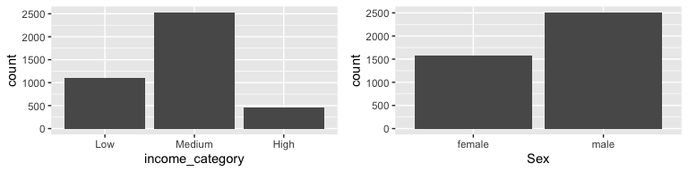
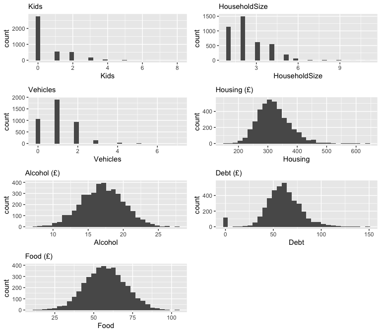
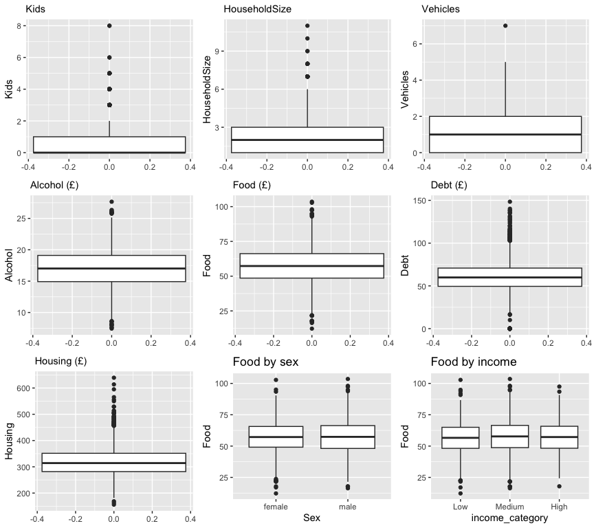
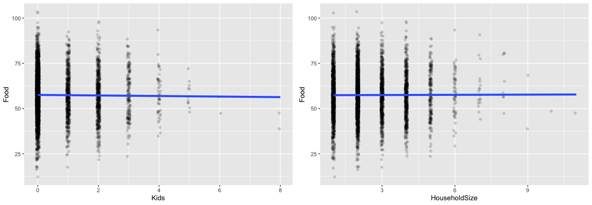
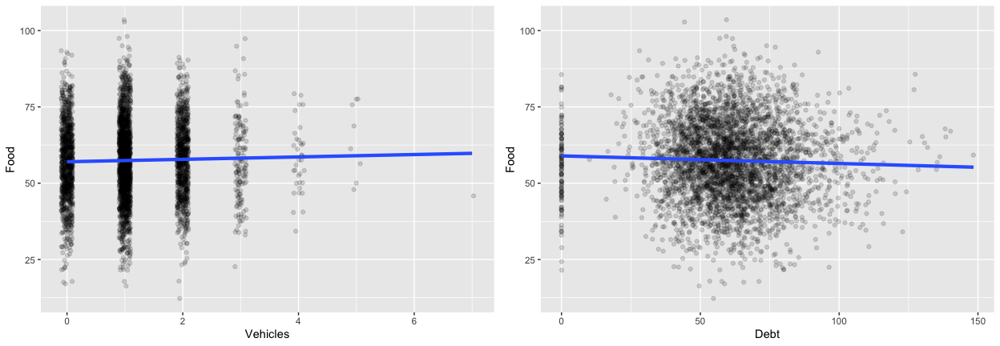
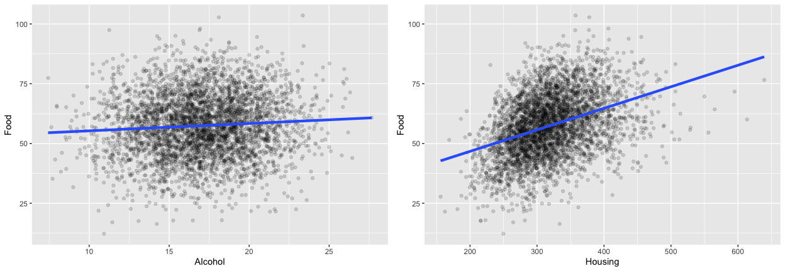
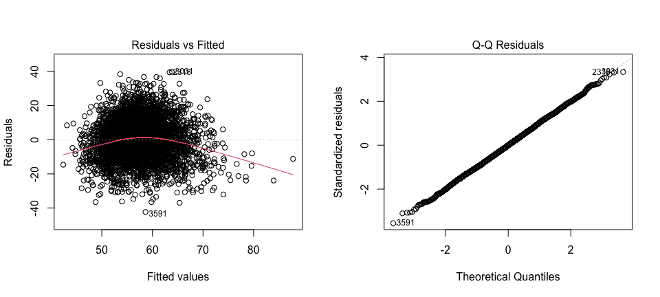
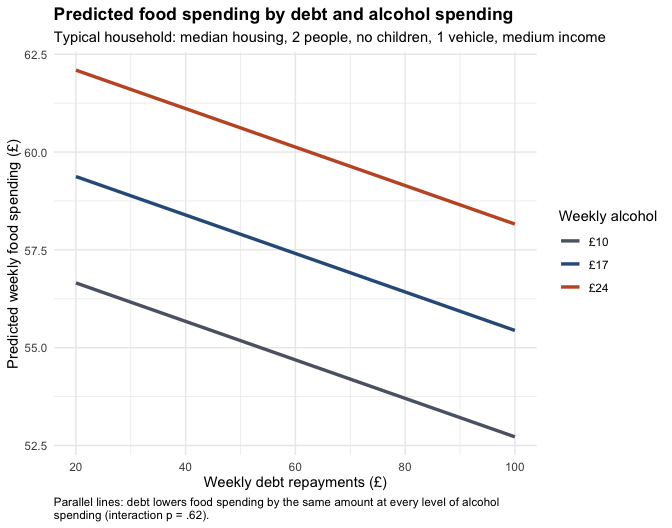

Household Expenditure: What Really Drives Food Spending?
================
Catalina Cortes Gutierrez
2026-10-24

This analysis looks at what predicts weekly food spending in 4,083 UK
households. It supports article \#3 of the *Business Data Lessons*
series: **the largest coefficient in a regression is not necessarily the
most important driver**.

*Originally developed for a university statistics assignment and revised
for publication. The dataset was provided by the course and is not
included in this repository.*

## Data dictionary

| Variable | Description |
|----|----|
| Kids | Number of children in the household |
| HouseholdSize | Total number of people living in the household |
| Sex | Gender of the survey respondent |
| Vehicles | Number of vehicles owned by the household |
| Food | Average weekly expenditure on food (£) |
| Housing | Average weekly expenditure on accommodation (£), including mortgage or rent |
| Alcohol | Average weekly expenditure on alcohol (£) |
| Debt | Average weekly debt repayments (£), including credit cards and bank loans, excluding mortgages |
| income_category | Household income level (Low, Medium, High) |

## 1. Load and check the data

``` r
library(Hmisc)      # rcorr()
library(tidyverse)
library(gridExtra)
library(car)        # vif()
```

``` r
householdExp <- read_csv("HouseholdExpenditure.csv")

str(householdExp)
```

    ## spc_tbl_ [4,097 × 9] (S3: spec_tbl_df/tbl_df/tbl/data.frame)
    ##  $ Kids           : num [1:4097] 0 4 2 0 0 0 3 3 2 3 ...
    ##  $ HouseholdSize  : num [1:4097] 3 5 3 2 1 1 6 5 4 4 ...
    ##  $ Sex            : chr [1:4097] "male" "female" "female" "male" ...
    ##  $ Vehicles       : num [1:4097] 0 1 2 0 1 0 1 1 2 3 ...
    ##  $ Food           : num [1:4097] 71.9 48.2 61.4 55.1 53.8 ...
    ##  $ Housing        : num [1:4097] 349 289 300 301 258 ...
    ##  $ Alcohol        : num [1:4097] 16.7 17.3 18.9 16.8 14.1 ...
    ##  $ Debt           : num [1:4097] 59 76.8 47.8 85.1 68.7 ...
    ##  $ income_category: chr [1:4097] "High" "Medium" "Low" "High" ...
    ##  - attr(*, "spec")=
    ##   .. cols(
    ##   ..   Kids = col_double(),
    ##   ..   HouseholdSize = col_double(),
    ##   ..   Sex = col_character(),
    ##   ..   Vehicles = col_double(),
    ##   ..   Food = col_double(),
    ##   ..   Housing = col_double(),
    ##   ..   Alcohol = col_double(),
    ##   ..   Debt = col_double(),
    ##   ..   income_category = col_character()
    ##   .. )
    ##  - attr(*, "problems")=<externalptr>

``` r
# Categorical variables are consistent, with no duplicated labels
lapply(householdExp[c("Sex", "income_category")], table)
```

    ## $Sex
    ## 
    ## female   male 
    ##   1577   2514 
    ## 
    ## $income_category
    ## 
    ##   High    Low Medium 
    ##    450   1105   2536

``` r
householdExp <- householdExp %>%
  mutate(
    Sex = factor(Sex),
    income_category = factor(income_category, levels = c("Low", "Medium", "High"))
  )

summary(householdExp)
```

    ##       Kids        HouseholdSize        Sex          Vehicles    
    ##  Min.   :0.0000   Min.   : 1.000   female:1577   Min.   :0.000  
    ##  1st Qu.:0.0000   1st Qu.: 1.000   male  :2514   1st Qu.:0.000  
    ##  Median :0.0000   Median : 2.000   NA's  :   6   Median :1.000  
    ##  Mean   :0.5849   Mean   : 2.378                 Mean   :1.077  
    ##  3rd Qu.:1.0000   3rd Qu.: 3.000                 3rd Qu.:2.000  
    ##  Max.   :8.0000   Max.   :11.000                 Max.   :7.000  
    ##  NA's   :6        NA's   :6                                     
    ##       Food           Housing         Alcohol            Debt       
    ##  Min.   : 12.25   Min.   :155.9   Min.   : 7.429   Min.   :  0.00  
    ##  1st Qu.: 48.59   1st Qu.:281.8   1st Qu.:14.920   1st Qu.: 49.46  
    ##  Median : 57.27   Median :314.1   Median :17.012   Median : 59.85  
    ##  Mean   : 57.44   Mean   :319.2   Mean   :17.014   Mean   : 59.97  
    ##  3rd Qu.: 66.21   3rd Qu.:351.3   3rd Qu.:19.099   3rd Qu.: 70.78  
    ##  Max.   :103.54   Max.   :639.2   Max.   :27.658   Max.   :148.41  
    ##                                                    NA's   :8       
    ##  income_category
    ##  Low   :1105    
    ##  Medium:2536    
    ##  High  : 450    
    ##  NA's  :   6    
    ##                 
    ##                 
    ## 

``` r
# 120 households (2.9%) report zero debt repayments
householdExp %>% filter(Debt == 0) %>% count()
```

    ## # A tibble: 1 × 1
    ##       n
    ##   <int>
    ## 1   120

``` r
# Rows with missing values
householdExp %>% filter(rowSums(is.na(.)) > 0) %>% as.data.frame()
```

    ##    Kids HouseholdSize    Sex Vehicles   Food Housing Alcohol   Debt
    ## 1     0             1 female        1 51.155  277.42  13.965     NA
    ## 2    NA            NA   <NA>        0 55.190  372.91  15.856 57.221
    ## 3     0             2   male        0 68.571  287.76  16.807     NA
    ## 4    NA            NA   <NA>        1 38.802  236.32   9.457 78.020
    ## 5     0             2   male        0 71.765  322.35  19.641     NA
    ## 6     1             2 female        2 55.957  335.54  14.315     NA
    ## 7    NA            NA   <NA>        1 52.172  356.02  17.950 54.398
    ## 8     0             1 female        1 46.129  310.99  19.437     NA
    ## 9    NA            NA   <NA>        2 25.614  342.76  10.584 54.018
    ## 10   NA            NA   <NA>        1 66.532  372.08  15.379 39.451
    ## 11    0             2   male        2 35.458  258.80  16.272     NA
    ## 12    3             5 female        0 50.729  270.94  19.089     NA
    ## 13    0             1 female        2 45.977  288.53  17.151     NA
    ## 14   NA            NA   <NA>        3 67.279  290.05  15.781 40.805
    ##    income_category
    ## 1              Low
    ## 2             <NA>
    ## 3           Medium
    ## 4             <NA>
    ## 5           Medium
    ## 6           Medium
    ## 7             <NA>
    ## 8              Low
    ## 9             <NA>
    ## 10            <NA>
    ## 11          Medium
    ## 12          Medium
    ## 13             Low
    ## 14            <NA>

## 2. Data cleaning

``` r
# Remove the 6 rows with several missing values and the 8 rows missing Debt
householdExp_filtered <- householdExp %>%
  filter(!(rowSums(is.na(.)) > 1)) %>%
  filter(!is.na(Debt))

nrow(householdExp_filtered)   # 4,083 rows remain
```

    ## [1] 4083

Fourteen rows (0.34%) were removed. The 120 households with zero debt
were kept: they are a real financial profile, not an error. Their food
spending is close to the rest of the sample:

``` r
householdExp_filtered %>%
  group_by(Zero_debt = Debt == 0) %>%
  summarise(Households = n(), Mean_food = round(mean(Food), 2)) %>%
  knitr::kable()
```

| Zero_debt | Households | Mean_food |
|:----------|-----------:|----------:|
| FALSE     |       3963 |     57.52 |
| TRUE      |        120 |     55.42 |

## 3. Distributions

``` r
hInCat <- ggplot(householdExp_filtered, aes(x = income_category)) + geom_bar()
hSex   <- ggplot(householdExp_filtered, aes(x = Sex)) + geom_bar()
grid.arrange(hInCat, hSex, nrow = 1)
```



``` r
# Kids, HouseholdSize, Vehicles and Housing are right-skewed; Debt has a spike at zero
hkids <- ggplot(householdExp_filtered) + geom_histogram(aes(x = Kids)) + labs(subtitle = "Kids")
hhhs  <- ggplot(householdExp_filtered) + geom_histogram(aes(x = HouseholdSize)) + labs(subtitle = "HouseholdSize")
hv    <- ggplot(householdExp_filtered) + geom_histogram(aes(x = Vehicles)) + labs(subtitle = "Vehicles")
hhou  <- ggplot(householdExp_filtered) + geom_histogram(aes(x = Housing)) + labs(subtitle = "Housing (£)")
ha    <- ggplot(householdExp_filtered) + geom_histogram(aes(x = Alcohol)) + labs(subtitle = "Alcohol (£)")
hd    <- ggplot(householdExp_filtered) + geom_histogram(aes(x = Debt)) + labs(subtitle = "Debt (£)")
hf    <- ggplot(householdExp_filtered) + geom_histogram(aes(x = Food)) + labs(subtitle = "Food (£)")
grid.arrange(hkids, hhhs, hv, hhou, ha, hd, hf, nrow = 4)
```



``` r
# Note the very different spreads: Housing SD ≈ £54, Debt ≈ £19, Alcohol ≈ £3
summary_table <- householdExp_filtered %>%
  summarise(across(c(Kids, HouseholdSize, Vehicles, Food, Housing, Debt, Alcohol), list(
    Median = ~median(.), Mean = ~mean(.), SD = ~sd(.), Min = ~min(.), Max = ~max(.)
  ))) %>%
  pivot_longer(everything(), names_to = c("Variable", ".value"), names_sep = "_") %>%
  mutate(across(where(is.numeric), ~round(., 2)))

knitr::kable(summary_table)
```

| Variable      | Median |   Mean |    SD |    Min |    Max |
|:--------------|-------:|-------:|------:|-------:|-------:|
| Kids          |   0.00 |   0.59 |  0.99 |   0.00 |   8.00 |
| HouseholdSize |   2.00 |   2.38 |  1.31 |   1.00 |  11.00 |
| Vehicles      |   1.00 |   1.08 |  0.86 |   0.00 |   7.00 |
| Food          |  57.30 |  57.46 | 12.94 |  12.25 | 103.54 |
| Housing       | 314.15 | 319.25 | 53.71 | 155.94 | 639.18 |
| Debt          |  59.88 |  59.98 | 19.43 |   0.00 | 148.42 |
| Alcohol       |  17.02 |  17.02 |  3.02 |   7.43 |  27.66 |

``` r
# Upper-tail outliers in Kids, HouseholdSize, Housing and Debt look plausible and are kept
gg.kids    <- ggplot(householdExp_filtered) + geom_boxplot(aes(y = Kids)) + labs(subtitle = "Kids")
gg.hhsize  <- ggplot(householdExp_filtered) + geom_boxplot(aes(y = HouseholdSize)) + labs(subtitle = "HouseholdSize")
gg.veh     <- ggplot(householdExp_filtered) + geom_boxplot(aes(y = Vehicles)) + labs(subtitle = "Vehicles")
gg.alcohol <- ggplot(householdExp_filtered) + geom_boxplot(aes(y = Alcohol)) + labs(subtitle = "Alcohol (£)")
gg.food    <- ggplot(householdExp_filtered) + geom_boxplot(aes(y = Food)) + labs(subtitle = "Food (£)")
gg.debt    <- ggplot(householdExp_filtered) + geom_boxplot(aes(y = Debt)) + labs(subtitle = "Debt (£)")
gg.housing <- ggplot(householdExp_filtered) + geom_boxplot(aes(y = Housing)) + labs(subtitle = "Housing (£)")

# Median food spending is similar across sex and income groups
gg.sex    <- ggplot(householdExp_filtered) + geom_boxplot(aes(x = Sex, y = Food)) + labs(title = "Food by sex")
gg.income <- ggplot(householdExp_filtered) + geom_boxplot(aes(x = income_category, y = Food)) + labs(title = "Food by income")

grid.arrange(gg.kids, gg.hhsize, gg.veh, gg.alcohol, gg.food, gg.debt, gg.housing, gg.sex, gg.income, nrow = 3)
```



## 4. Relationships between variables

``` r
# Kids and HouseholdSize: almost flat slopes
gg.kidsF <- ggplot(householdExp_filtered, aes(x = Kids, y = Food)) +
  geom_jitter(alpha = 0.15, width = 0.05) + geom_smooth(method = "lm", linewidth = 1.5, se = FALSE)
gg.hhsF <- ggplot(householdExp_filtered, aes(x = HouseholdSize, y = Food)) +
  geom_jitter(alpha = 0.15, width = 0.05) + geom_smooth(method = "lm", linewidth = 1.5, se = FALSE)
grid.arrange(gg.kidsF, gg.hhsF, nrow = 1)
```



``` r
# Vehicles: flat slope. Debt: weak negative slope
gg.vehF <- ggplot(householdExp_filtered, aes(x = Vehicles, y = Food)) +
  geom_jitter(alpha = 0.15, width = 0.1) + geom_smooth(method = "lm", linewidth = 1.5, se = FALSE)
gg.debtF <- ggplot(householdExp_filtered, aes(x = Debt, y = Food)) +
  geom_jitter(alpha = 0.15, width = 0.1) + geom_smooth(method = "lm", linewidth = 1.5, se = FALSE)
grid.arrange(gg.vehF, gg.debtF, nrow = 1)
```



``` r
# Alcohol: the slope looks flat because alcohol varies very little between households (SD ≈ £3).
# The regression below shows it is a significant predictor per £1, but a typical change is small.
# Housing: clear positive relationship
gg.alcF <- ggplot(householdExp_filtered, aes(x = Alcohol, y = Food)) +
  geom_jitter(alpha = 0.15, width = 0.1) + geom_smooth(method = "lm", linewidth = 1.5, se = FALSE)
gg.housF <- ggplot(householdExp_filtered, aes(x = Housing, y = Food)) +
  geom_jitter(alpha = 0.15, width = 0.1) + geom_smooth(method = "lm", linewidth = 1.5, se = FALSE)
grid.arrange(gg.alcF, gg.housF, nrow = 1)
```



``` r
# Spearman correlation: robust to skewed distributions and outliers
rcorr(as.matrix(select(householdExp_filtered,
                       Food, Alcohol, Debt, Housing, HouseholdSize, Kids, Vehicles)),
      type = "spearman")
```

    ##                Food Alcohol  Debt Housing HouseholdSize  Kids Vehicles
    ## Food           1.00    0.07 -0.06    0.38         -0.01 -0.02     0.02
    ## Alcohol        0.07    1.00  0.16   -0.02         -0.02 -0.01    -0.02
    ## Debt          -0.06    0.16  1.00    0.08          0.00 -0.01    -0.03
    ## Housing        0.38   -0.02  0.08    1.00          0.02  0.01     0.00
    ## HouseholdSize -0.01   -0.02  0.00    0.02          1.00  0.76     0.03
    ## Kids          -0.02   -0.01 -0.01    0.01          0.76  1.00     0.01
    ## Vehicles       0.02   -0.02 -0.03    0.00          0.03  0.01     1.00
    ## 
    ## n= 4083 
    ## 
    ## 
    ## P
    ##               Food   Alcohol Debt   Housing HouseholdSize Kids   Vehicles
    ## Food                 0.0000  0.0002 0.0000  0.6865        0.2712 0.1106  
    ## Alcohol       0.0000         0.0000 0.2999  0.1338        0.5466 0.1431  
    ## Debt          0.0002 0.0000         0.0000  0.9414        0.7438 0.0383  
    ## Housing       0.0000 0.2999  0.0000         0.2074        0.6374 0.8516  
    ## HouseholdSize 0.6865 0.1338  0.9414 0.2074                0.0000 0.0770  
    ## Kids          0.2712 0.5466  0.7438 0.6374  0.0000               0.4549  
    ## Vehicles      0.1106 0.1431  0.0383 0.8516  0.0770        0.4549

Housing and Food have a moderate positive association
($r_s = .38, p < .001$). Debt and Food have a small negative association
($r_s = -.06, p < .001$), and Alcohol and Food a weak positive one
($r_s = .07, p < .001$).

These correlations are with the outcome, so they say nothing about
multicollinearity. Multicollinearity is about correlations *between
predictors*, and it is checked with VIFs after fitting the model
(section 5).

**Why both approaches?** The correlations are exploratory: each one
looks at a single pair of variables and ignores everything else.
Conclusions and effect sizes come from the multiple regression in
section 5, because it estimates the effect of each predictor while
holding the others constant.

## 5. Key drivers of food spending

``` r
m.food <- lm(Food ~ Alcohol + Debt + Housing + HouseholdSize +
               Kids + Vehicles + income_category + Sex,
             data = householdExp_filtered)

summary(m.food)
```

    ## 
    ## Call:
    ## lm(formula = Food ~ Alcohol + Debt + Housing + HouseholdSize + 
    ##     Kids + Vehicles + income_category + Sex, data = householdExp_filtered)
    ## 
    ## Residuals:
    ##     Min      1Q  Median      3Q     Max 
    ## -42.300  -8.124  -0.090   8.081  39.699 
    ## 
    ## Coefficients:
    ##                        Estimate Std. Error t value Pr(>|t|)    
    ## (Intercept)           23.472590   1.688695  13.900  < 2e-16 ***
    ## Alcohol                0.388444   0.062415   6.224 5.35e-10 ***
    ## Debt                  -0.049175   0.009718  -5.060 4.38e-07 ***
    ## Housing                0.091439   0.003485  26.241  < 2e-16 ***
    ## HouseholdSize          0.175645   0.291747   0.602   0.5472    
    ## Kids                  -0.412563   0.354191  -1.165   0.2442    
    ## Vehicles               0.360337   0.216622   1.663   0.0963 .  
    ## income_categoryMedium  0.928248   0.477733   1.943   0.0521 .  
    ## income_categoryHigh    0.392923   0.749619   0.524   0.6002    
    ## Sexmale               -0.083423   0.405226  -0.206   0.8369    
    ## ---
    ## Signif. codes:  0 '***' 0.001 '**' 0.01 '*' 0.05 '.' 0.1 ' ' 1
    ## 
    ## Residual standard error: 11.91 on 4073 degrees of freedom
    ## Multiple R-squared:  0.1536, Adjusted R-squared:  0.1517 
    ## F-statistic:  82.1 on 9 and 4073 DF,  p-value: < 2.2e-16

``` r
confint(m.food)
```

    ##                              2.5 %      97.5 %
    ## (Intercept)           20.161823787 26.78335593
    ## Alcohol                0.266075449  0.51081238
    ## Debt                  -0.068228709 -0.03012171
    ## Housing                0.084606809  0.09827037
    ## HouseholdSize         -0.396338881  0.74762984
    ## Kids                  -1.106971175  0.28184507
    ## Vehicles              -0.064361166  0.78503482
    ## income_categoryMedium -0.008370389  1.86486603
    ## income_categoryHigh   -1.076740484  1.86258585
    ## Sexmale               -0.877887408  0.71104218

``` r
# Multicollinearity check: all VIFs should be below 5
vif(m.food)
```

    ##                     GVIF Df GVIF^(1/(2*Df))
    ## Alcohol         1.021491  1        1.010688
    ## Debt            1.024802  1        1.012325
    ## Housing         1.007108  1        1.003548
    ## HouseholdSize   4.177179  1        2.043815
    ## Kids            3.569563  1        1.889329
    ## Vehicles        1.004962  1        1.002478
    ## income_category 1.349719  2        1.077856
    ## Sex             1.118309  1        1.057501

The model is significant ($F(9, 4073) = 82.1, p < .001$, $N = 4,083$)
and explains about 15% of the variation in food spending (adjusted
$R^2 = 0.152$). Three variables are significant predictors, holding the
others constant:

- **Housing:** each extra £1 predicts £0.09 more on food (95% CI \[0.08,
  0.10\]), $t(4073) = 26.24, p < .001$.
- **Alcohol:** each extra £1 predicts £0.39 more on food (95% CI \[0.27,
  0.51\]), $t(4073) = 6.22, p < .001$.
- **Debt:** each extra £1 predicts £0.05 less on food (95% CI \[-0.07,
  -0.03\]), $t(4073) = -5.06, p < .001$.

Household size, children, vehicles, income category and respondent sex
are not significant ($p > .05$). All VIFs are below 5, so
multicollinearity is not a problem.

The intercept (£23.47) is not meaningful on its own: it describes a
household with zero housing costs, zero people and zero vehicles, which
does not exist.

### Raw coefficients cannot be compared directly

Alcohol has the largest coefficient (£0.39 per £1), but that does not
make it the most important driver. The variables move on very different
scales: £1 is a big change in alcohol spending and a tiny one in housing
spending. To compare them fairly, multiply each coefficient by how much
that variable typically varies (its standard deviation).

``` r
key_vars <- c("Housing", "Alcohol", "Debt")

std_effects <- tibble(
  Variable    = key_vars,
  Coefficient = coef(m.food)[key_vars],
  SD          = sapply(householdExp_filtered[key_vars], sd)
) %>%
  mutate(
    Effect_1SD   = Coefficient * SD,                          # £ change in food for a typical change
    Std_beta     = Effect_1SD / sd(householdExp_filtered$Food) # fully standardised coefficient
  ) %>%
  arrange(desc(abs(Effect_1SD)))

knitr::kable(std_effects, digits = c(0, 3, 2, 2, 3),
             col.names = c("Variable", "Coefficient (per £1)", "SD (£)",
                           "Effect of 1 SD change (£)", "Standardised beta"))
```

| Variable | Coefficient (per £1) | SD (£) | Effect of 1 SD change (£) | Standardised beta |
|:---|---:|---:|---:|---:|
| Housing | 0.091 | 53.71 | 4.91 | 0.380 |
| Alcohol | 0.388 | 3.02 | 1.17 | 0.091 |
| Debt | -0.049 | 19.43 | -0.96 | -0.074 |

A typical change in housing spending (about £54) moves food spending by
about **£4.9**. A typical change in alcohol spending (about £3) moves it
by about **£1.2**, and in debt (about £19) by about **−£1.0**. **Housing
is roughly four times as important as alcohol**, even though its
coefficient is four times smaller.

### Why are children and household size not significant?

They are not significant even on their own, so the result is not caused
by multicollinearity between them. In this data, they simply do not
explain food spending.

``` r
m.kids   <- lm(Food ~ Kids, data = householdExp_filtered)
m.hhsize <- lm(Food ~ HouseholdSize, data = householdExp_filtered)

tibble(
  Model    = c("Food ~ Kids", "Food ~ HouseholdSize"),
  Estimate = c(coef(m.kids)["Kids"], coef(m.hhsize)["HouseholdSize"]),
  p_value  = c(coef(summary(m.kids))["Kids", "Pr(>|t|)"],
               coef(summary(m.hhsize))["HouseholdSize", "Pr(>|t|)"])
) %>%
  knitr::kable(digits = 3)
```

| Model                | Estimate | p_value |
|:---------------------|---------:|--------:|
| Food ~ Kids          |   -0.153 |   0.451 |
| Food ~ HouseholdSize |    0.036 |   0.815 |

### Model assumptions

``` r
# Residuals vs fitted: checks linearity and constant variance
# Normal Q-Q: checks that residuals are approximately normal
par(mfrow = c(1, 2))
plot(m.food, which = 1:2)
```



``` r
par(mfrow = c(1, 1))
```

### Robustness check: households with zero debt

Debt has a spike at zero (120 households). These values are plausible
(many households have no loans or credit card debt), so they are not
treated as errors. A spike in a *predictor* does not by itself break the
regression assumptions, which concern the residuals (checked above).
Still, to make sure these households do not drive the results, the model
is refitted without them:

``` r
m.food.nozero <- lm(Food ~ Alcohol + Debt + Housing + HouseholdSize +
                      Kids + Vehicles + income_category + Sex,
                    data = filter(householdExp_filtered, Debt > 0))

tibble(
  Variable          = key_vars,
  All_households    = coef(m.food)[key_vars],
  Without_zero_debt = coef(m.food.nozero)[key_vars]
) %>%
  knitr::kable(digits = 3, col.names = c("Variable", "All households (n = 4,083)",
                                         "Without zero debt (n = 3,963)"))
```

| Variable | All households (n = 4,083) | Without zero debt (n = 3,963) |
|:---------|---------------------------:|------------------------------:|
| Housing  |                      0.091 |                         0.093 |
| Alcohol  |                      0.388 |                         0.414 |
| Debt     |                     -0.049 |                        -0.084 |

The conclusions hold: all three predictors remain significant and
housing remains the strongest driver. The debt effect becomes larger
without the zero-debt households (about −£0.08 vs −£0.05 per £1), so
including them makes the debt estimate slightly conservative. They are
kept because they are real households.

## 6. Is the effect of debt the same at different levels of alcohol spending?

Debt and Alcohol are centred (mean subtracted) before creating the
interaction. This avoids the artificial multicollinearity that appears
when two raw variables are multiplied, without changing the interaction
test.

``` r
householdExp_filtered <- householdExp_filtered %>%
  mutate(
    Debt_c    = Debt - mean(Debt),
    Alcohol_c = Alcohol - mean(Alcohol)
  )

m.interaction <- lm(Food ~ Debt_c * Alcohol_c + Housing + HouseholdSize +
                      Kids + Vehicles + income_category + Sex,
                    data = householdExp_filtered)

summary(m.interaction)
```

    ## 
    ## Call:
    ## lm(formula = Food ~ Debt_c * Alcohol_c + Housing + HouseholdSize + 
    ##     Kids + Vehicles + income_category + Sex, data = householdExp_filtered)
    ## 
    ## Residuals:
    ##     Min      1Q  Median      3Q     Max 
    ## -42.266  -8.132  -0.073   8.076  39.685 
    ## 
    ## Coefficients:
    ##                        Estimate Std. Error t value Pr(>|t|)    
    ## (Intercept)           27.159700   1.238894  21.923  < 2e-16 ***
    ## Debt_c                -0.049076   0.009721  -5.048 4.66e-07 ***
    ## Alcohol_c              0.388213   0.062423   6.219 5.50e-10 ***
    ## Housing                0.091406   0.003486  26.224  < 2e-16 ***
    ## HouseholdSize          0.175203   0.291776   0.600   0.5482    
    ## Kids                  -0.413691   0.354231  -1.168   0.2429    
    ## Vehicles               0.358828   0.216663   1.656   0.0978 .  
    ## income_categoryMedium  0.929349   0.477782   1.945   0.0518 .  
    ## income_categoryHigh    0.398080   0.749760   0.531   0.5955    
    ## Sexmale               -0.086225   0.405303  -0.213   0.8315    
    ## Debt_c:Alcohol_c      -0.001549   0.003110  -0.498   0.6185    
    ## ---
    ## Signif. codes:  0 '***' 0.001 '**' 0.01 '*' 0.05 '.' 0.1 ' ' 1
    ## 
    ## Residual standard error: 11.92 on 4072 degrees of freedom
    ## Multiple R-squared:  0.1536, Adjusted R-squared:  0.1515 
    ## F-statistic:  73.9 on 10 and 4072 DF,  p-value: < 2.2e-16

``` r
vif(m.interaction)
```

    ##                      GVIF Df GVIF^(1/(2*Df))
    ## Debt_c           1.025237  1        1.012540
    ## Alcohol_c        1.021547  1        1.010716
    ## Housing          1.007462  1        1.003724
    ## HouseholdSize    4.177218  1        2.043824
    ## Kids             3.569709  1        1.889367
    ## Vehicles         1.005158  1        1.002576
    ## income_category  1.349995  2        1.077911
    ## Sex              1.118525  1        1.057603
    ## Debt_c:Alcohol_c 1.001582  1        1.000791

There is no significant interaction between debt and alcohol spending
($t(4072) = -0.50, p = .62$). The negative effect of debt on food
spending is the same whatever a household spends on alcohol, and adding
the interaction does not improve the model (adjusted $R^2$ 0.1515 vs
0.1517). The simpler main-effects model is kept.

``` r
food.preds <- tibble(
  Alcohol = rep(c(10, 17, 24), 3),            # low, typical and high alcohol spending
  Debt = rep(c(20, 60, 100), each = 3),
  Housing = median(householdExp_filtered$Housing),
  HouseholdSize = 2,
  Kids = 0,
  Vehicles = 1,
  income_category = factor("Medium", levels = c("Low", "Medium", "High")),
  Sex = factor("male", levels = levels(householdExp_filtered$Sex))
) %>%
  mutate(food.hat = predict(m.food, newdata = .))

ggplot(food.preds, aes(x = Debt, y = food.hat, colour = factor(Alcohol))) +
  geom_line(linewidth = 1.2) +
  scale_colour_manual(values = c("#5B6474", "#2F5D8A", "#C4572B"),
                      labels = c("£10", "£17", "£24")) +
  labs(
    title = "Predicted food spending by debt and alcohol spending",
    subtitle = "Typical household: median housing, 2 people, no children, 1 vehicle, medium income",
    colour = "Weekly alcohol",
    x = "Weekly debt repayments (£)",
    y = "Predicted weekly food spending (£)",
    caption = "Parallel lines: debt lowers food spending by the same amount at every level of alcohol\nspending (interaction p = .62)."
  ) +
  theme_minimal() +
  theme(plot.title = element_text(face = "bold"),
        plot.caption = element_text(hjust = 0))
```



## 7. Figures for the article (Spanish)
